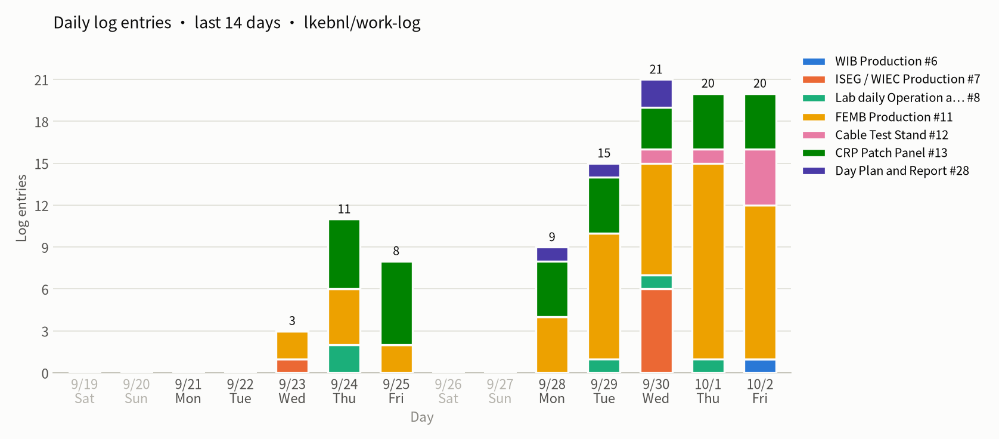
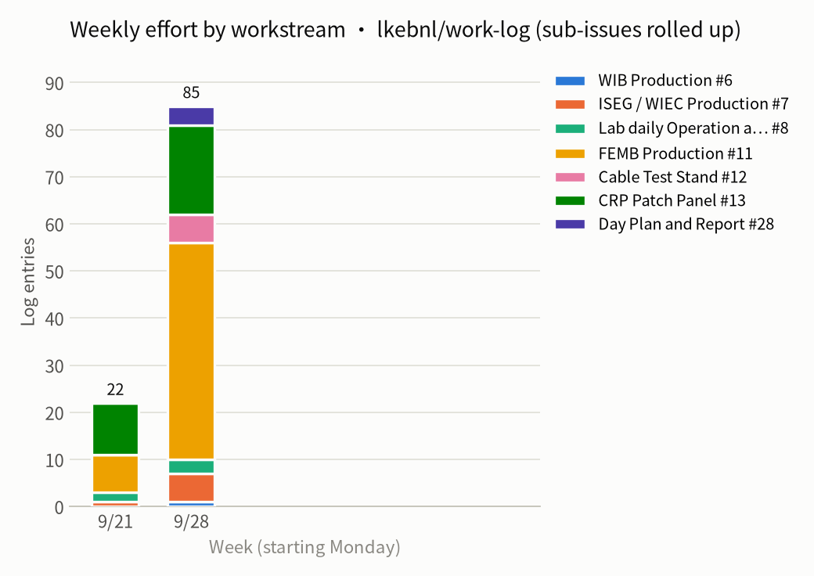

# Weekly report 2026-W40 (09-28 – 10-02)

- Window (New York): 2026-09-28 00:00 → 2026-10-02 20:08
- Issues with activity: 25 (opened 16, closed 8); comments: 85
- Source: issue comments and status events fetched by script, no AI; issue bodies not included

## Charts





## Workstreams

| Workstream | Comments | Opened | Closed | Issues with activity |
|---|---:|---:|---:|---|
| [WIB Production] #6 | 1 | 1 | 0 | #33 |
| [ISEG / WIEC Production]  #7 | 6 | 2 | 1 | #7 #34 #35 |
| [Lab daily Operation and Maintenance] #8 | 3 | 0 | 0 | #8 |
| [FEMB Production] #11 | 46 | 6 | 2 | #14 #44 #49 #51 #55 #19 #23 #27 #45 #52 |
| [Cable Test Stand] #12 | 6 | 3 | 1 | #46 #50 #54 |
| [CRP Patch Panel] #13 | 19 | 3 | 4 | #13 #21 #25 #30 #31 #48 |
| Day Plan and Report #28 | 4 | 1 | 0 | #28 |

## Closed this week

- #46 SD card connection warning (09-30, closed)
- #35 U-I curve (09-30, closed)
- #31 QR code and Box (09-30, closed)
- #30 pop-windows (09-29, closed)
- #25 ask Augie to modify the test set (09-28, closed)
- #21 List of CRP Patch Panel Test Stand (09-29, closed)
- #19 CE Box (09-28, closed)
- #19 CE Box (10-02, closed)

## Opened this week

- #55 Cable Bundle issue at CTS_1 (10-02)
- #54 Cable Corrosion (10-02)
- #52 QR Code Plan (10-02)
- #51 train cases (10-01)
- #50 Cable Test (10-01)
- #49 update P4 inspection procedure at post-assembly checkout (10-01)
- #48 Shanshan's review (10-01)
- #46 SD card connection warning (09-30)
- #45 Test environment issue debug (09-30)
- #44 P4 Data connector issue for BNL_FEMB_IO-1865-1K_00005 (09-30)
- #35 U-I curve (09-29)
- #34 Pop-windows (09-29)
- #33 issue board back from CERN, debug by Jack (09-29)
- #31 QR code and Box (09-29)
- #30 pop-windows (09-28)
- #28 Day Plan and Report (09-28)

## Open issues with no update for over 7 days

- (none)

## Details

### [WIB Production] #6

#### #33 issue board back from CERN, debug by Jack · open

- **09-29 17:23** · lkebnl · status: opened
- **10-02 17:47** · lkebnl · [comment](https://github.com/lkebnl/work-log/issues/33#issuecomment-5961999005)
  > Shanshan give us the board. we'll take the board, run a QC test on it, and keep it at BNL for debugging or local QC testing. The FPGA pins may have been damaged by electrostatic discharge, so the board will stay here.
  > seems some one disassembly the chip U10 and cause issues

### [ISEG / WIEC Production]  #7

- **09-30 23:20** · lkebnl · [comment](https://github.com/lkebnl/work-log/issues/7#issuecomment-5924050189)
  > Resource 01
  > [FW__ISEG_HV_power_supplies.zip](https://github.com/user-attachments/files/32884980/FW__ISEG_HV_power_supplies.zip)
- **09-30 23:21** · lkebnl · [comment](https://github.com/lkebnl/work-log/issues/7#issuecomment-5924063034)
  > [HV_module_measurement_07272026 (1).pptx](https://github.com/user-attachments/files/32885019/HV_module_measurement_07272026.1.pptx)
  >
  > [HVPS QC Test Procedures_6-6-2026_note.docx](https://github.com/user-attachments/files/32885033/HVPS.QC.Test.Procedures_6-6-2026_note.docx)

#### #34 Pop-windows · open

- **09-29 18:41** · lkebnl · status: opened
- **09-30 14:09** · lkebnl · [comment](https://github.com/lkebnl/work-log/issues/34#issuecomment-5916968537)
  > re-organize the slides
  > shown in the link
  > https://docs.google.com/presentation/d/1iRu4WtnZPgXYoQ-CYFmcQz8_89XMsMYefvMnc-w_7Dc/edit?slide=id.p#slide=id.p
- **09-30 20:39** · lkebnl · [comment](https://github.com/lkebnl/work-log/issues/34#issuecomment-5922351240)
  > for the test setup, we made an extend power cable to provide 5 V for SL - lock slot
  >
  > ****

#### #35 U-I curve · closed

- **09-29 18:42** · lkebnl · status: opened
- **09-30 18:41** · lkebnl · status: closed
- **09-30 18:42** · lkebnl · [comment](https://github.com/lkebnl/work-log/issues/35#issuecomment-5920978613)
  > completed and verify the design
- **09-30 18:50** · lkebnl · [comment](https://github.com/lkebnl/work-log/issues/35#issuecomment-5921072884)
  > [IV.zip](https://github.com/user-attachments/files/32879679/IV.zip)
  > [readme06.md](https://github.com/user-attachments/files/32879680/readme06.md)

### [Lab daily Operation and Maintenance] #8

- **09-29 14:11** · lkebnl · [comment](https://github.com/lkebnl/work-log/issues/8#issuecomment-5895931626)
  > Chris think the QR Scanner, which optimized for fast, high-volume scanning, is not suitable for him
  > we give the compact screen-equipped scanner to him, which works fine for the QR scan for the samtec cable
- **09-30 09:42** · lkebnl · [comment](https://github.com/lkebnl/work-log/issues/8#issuecomment-5912508861)
  > completed the train of LAB
- **10-01 12:10** · lkebnl · [comment](https://github.com/lkebnl/work-log/issues/8#issuecomment-5935454991)
  > Yichen Refill 3 Dewar for CTS

### [FEMB Production] #11

#### #14 shifter for HD / VD FEMB 09232026 · open

- **09-28 12:47** · lkebnl · [comment](https://github.com/lkebnl/work-log/issues/14#issuecomment-5874528815)
  > CE cover 0010 is not wide enough, Manhong solve this issue
  > install 1826-1L-0051 into CE box, Augie have repair the CE box base
  >
  > for the issue cover, Manhong said that
  > Lingyun discussed the CE box cover fitting issue with me. Some of the CE box covers do not fit well on the CE box bases.
  > I measured the CE box dimensions and reviewed the drawings with Jason. The parts are at the dimensional limits, but they still meet the current drawing requirements: the covers are near the lower limit and the bases are near the upper limit. 
  > According to our drawing:
  > CE box cover outer width: 195.2 mm
  > CE box base outer width: 191.0 mm
  > With the 1 mm profile tolerance, the acceptable cover width is 194.7–195.7 mm, and the acceptable base width is 190.5–191.5 mm.
  > Considering the cover material thickness of 1.57 mm, the cover inner width is 191.56–192.56 mm.
  > Therefore, even in the worst case, a minimum-size cover with an inner width of 191.56 mm fitted over a maximum-size base with an outer width of 191.5 mm, theoretically there is still 0.06 mm clearance.
  > However, during the review we identified an additional tolerance that was not accounted for. Datum B is defined on one side of the cover, and the cover width is measured from this datum. Although Datum B itself is theoretically flat, the actual side surface used to establish the datum is still subject to the 1 mm global profile tolerance. This additional geometric variation can contribute to the fitting interference we are seeing.
  > After reviewing this carefully, we propose increasing the CE box cover width by 1.0 mm, from 195.2 mm to 196.2 mm, to provide additional clearance and account for this missed tolerance.
  > For the CE box covers we already have on hand, the interference appears to be relatively minor. We are looking into whether a simple fixture can be used to slightly bend the two sides of the covers outward so that they fit properly on the existing bases.
- **09-28 17:30** · lkebnl · [comment](https://github.com/lkebnl/work-log/issues/14#issuecomment-5879089727)
  > Lingyun Tested 1826-1L-58 and 1826-1L-27, both pass the QC
- **09-28 17:31** · lkebnl · [comment](https://github.com/lkebnl/work-log/issues/14#issuecomment-5879104265)
  > Xuyang Tested 1865-1k-35 and 1865-1k-06, both pass the QC
- **09-29 11:49** · lkebnl · [comment](https://github.com/lkebnl/work-log/issues/14#issuecomment-5893691730)
  > Karla Test BNL_FEMB_IO-1865-1K_00024 and BNL_FEMB_IO-1865-1K_00032 all pass the QC Test
- **09-29 14:38** · lkebnl · [comment](https://github.com/lkebnl/work-log/issues/14#issuecomment-5896364728)
  > Karla Test BNL_FEMB_IO-1865-1K_00004 and BNL_FEMB_IO-1865-1K_00010, all pass the QC Test
- **09-30 11:12** · lkebnl · [comment](https://github.com/lkebnl/work-log/issues/14#issuecomment-5914113729)
  > Kyra test FEMB BNL_FEMB_I0-1865-1J_00012 and BNL_FEMB_IO-1865-1K_00005
  > but the board 05 meet connector issue. after talk with Shanshan, it was hurt at CERN and the reason is that A-tech should fill the hole.
  >
  > 
  >
  >
  > now, we change the FEMB pair
  > BNL_FEMB_I0-1865-1J_00012 and BNL_FEMB_IO-1865-1K_00033, both pass the QC test
- **09-30 20:40** · lkebnl · [comment](https://github.com/lkebnl/work-log/issues/14#issuecomment-5922370163)
  > Kyra test FEMB BNL_FEMB_IO-1865-1K_00016 and BNL_FEMB_IO-1865-1K_00020, both pass the QC test
- **10-01 15:34** · lkebnl · [comment](https://github.com/lkebnl/work-log/issues/14#issuecomment-5939062110)
  > > CE cover 0010 is not wide enough, Manhong solve this issue install 1826-1L-0051 into CE box, Augie have repair the CE box base
  > > 
  > > for the issue cover, Manhong said that Lingyun discussed the CE box cover fitting issue with me. Some of the CE box covers do not fit well on the CE box bases. I measured the CE box dimensions and reviewed the drawings with Jason. The parts are at the dimensional limits, but they still meet the current drawing requirements: the covers are near the lower limit and the bases are near the upper limit. According to our drawing: CE box cover outer width: 195.2 mm CE box base outer width: 191.0 mm With the 1 mm profile tolerance, the acceptable cover width is 194.7–195.7 mm, and the acceptable base width is 190.5–191.5 mm. Considering the cover material thickness of 1.57 mm, the cover inner width is 191.56–192.56 mm. Therefore, even in the worst case, a minimum-size cover with an inner width of 191.56 mm fitted over a maximum-size base with an outer width of 191.5 mm, theoretically there is still 0.06 mm clearance. However, during the review we identified an additional tolerance that was not accounted for. Datum B is defined on one side of the cover, and the cover width is measured from this datum. Although Datum B itself is theoretically flat, the actual side surface used to establish the datum is still subject to the 1 mm global profile tolerance. This additional geometric variation can contribute to the fitting interference we are seeing. After reviewing this carefully, we propose increasing the CE box cover width by 1.0 mm, from 195.2 mm to 196.2 mm, to provide additional clearance and account for this missed tolerance. For the CE box covers we already have on hand, the interference appears to be relatively minor. We are looking into whether a simple fixture can be used to slightly bend the two sides of the covers outward so that they fit properly on the existing bases.
  >
  > > Thanks Manhong for the careful investigation!
  > >
  > > > After reviewing this carefully, we propose increasing the CE box cover width by 1.0 mm, from 195.2 mm to 196.2 mm, to provide additional clearance and account for this missed tolerance.
  > > Sounds good to me. This means we need to send updated drawings to
  > > Zober for phase 2 VD CE box PO, and MDI for phase 1 HD CE box PO?
  > >
  > > > We are looking into whether a simple fixture can be used to slightly bend the two sides of the covers outward so that they fit properly on the existing bases.
  > > Very good. I presume you will talk to Augie about this?
  > >
  > > Regards,
  > > Hucheng
  >
  > > Hi Hucheng,
  > >
  > > Besides bending the cover, it may be better to bend the base as well. Augie is not here today, so I’ll talk with him tomorrow about how to do this in a controlled manner, perhaps simply using a machine‑shop vise.
  > >
  > > We will also update the model and drawing by increasing the cover width by 1 mm, and then send the revised drawing and model to MDI and Zober.
  > >
  > > Best regards,
  > >
  > > Manhong
  >
  > Thanks Manhong and Augie.
  >
  > > We will also update the model and drawing by increasing the cover width by 1 mm, and then send the revised drawing and model to MDI and Zober.
  > We should do this soon, so it won't become too late for Zober and MDI
  > to use new drawings.
  >
  > Regards,
  > Hucheng
  >
  > Hi Hucheng,
  > Thanks for the reminder. I’ve updated the CE box cover model to increase the cover width by 1 mm, and the updated model is attached.
  > @Farrell, Jason G, could you please update the drawings DCCBL0102 Rev A and DCCBL010201 Rev A to implement this change and up‑rev both drawings to Rev B? Once the updated drawings are ready, we will send them to MDI and Zober.
  > At the same time, I will also send a heads‑up message to Zober and MDI letting them know that the cover width will be increased by 1 mm so they can plan accordingly.
  > Best regards,
  >
  > Manhong
  >
  > 
  >
  >
  > It seems the box part is slightly bowed. I used a 1mm piece of aluminum on center of each side and put it in vise. Crude but it seems to be OK.
  >
  > When working on CE boxes I mostly installed cover with tabs first and the covers did go on this way before I  put them in the vise. Adding 1mm to drawing seems like a good idea!
  >
  >
  > 
  >
  >
  > Manhong Give the board and repaired cover back
- **10-01 16:39** · lkebnl · [comment](https://github.com/lkebnl/work-log/issues/14#issuecomment-5940108317)
  > Lou test 00056_BNL_FEMB_I0-1865-1J and BNL_FEMB_IO-1865-1K_00014, both pass the QC
- **10-01 16:42** · lkebnl · [comment](https://github.com/lkebnl/work-log/issues/14#issuecomment-5940169176)
  > Lou tested BNL_FEMB_IO-1865-1K_00040 and BNL_FEMB_IO-1865-1K_00030; both passed QC.
  >
  > One safety note: during warm-up, Lou attempted to open the cover and lift the CE support structure while LN2 was still in the chamber. As a lesson learned, we added a warning to the test script to block this operation, since exposure to LN2 poses a serious hazard to personnel.
- **10-02 20:04** · lkebnl · [comment](https://github.com/lkebnl/work-log/issues/14#issuecomment-5963406258)
  > Shanshan Tested FEMB BNL_FEMB_IO-1865-1K_00027 and BNL_FEMB_IO-1865-1K_00007, both pass the QC
- **10-02 20:06** · lkebnl · [comment](https://github.com/lkebnl/work-log/issues/14#issuecomment-5963418254)
  > Lingyun tested FEMB BNL_FEMB_IO-1865-1K_00005 and BNL_FEMB_IO-1865-1K_00001, both pass the QC

##### #44 P4 Data connector issue for BNL_FEMB_IO-1865-1K_00005 · open

- **09-30 20:42** · lkebnl · status: opened
- **09-30 20:43** · lkebnl · [comment](https://github.com/lkebnl/work-log/issues/44#issuecomment-5922401225)
  > 
- **10-01 12:24** · lkebnl · [comment](https://github.com/lkebnl/work-log/issues/44#issuecomment-5935716101)
  > Dear Chen,
  >
  >       >  I presume this has been addressed in the recent assembly of VD FEMBs, please check with Shanshan to confirm.
  >
  >            I took a look at the board yesterday. We already have the assembly note requiring the 100% hole fill for the through-holes. This is an defective board AA-tech delivered to us and we didn’t catch it earlier.
  >
  >
  >
  >            I will report this insufficient soldering issue back to AA-tech. For the coming FEMB assembly, I’ll ask them to adopt the same method they used for CRP patch panel to get 100%-hole fill.
  >
  >
  >
  >            Further more, Lingyun should update the post-assembly testing procedure,  add one more visual inspection procedure to confirm the cage is properly soldered.
  >
  >
  >
  >             @Ke, Lingyun did Karla take pictures for this board via the photo booths, can you locate the photos?
  >
  >
  >
  >
  >
  >              > I presume the CRP patch panel has Data Matrix code, so we don't need the QR code on the foam box, right?
  >
  >                  Each foam box will fit in 4 CRP patch panel, the QR code will attach to the static bag for each board. The HWDB QR code is used to entry the QC test result into HWDB.
  >
  >
  >
  > Regards,
  >
  > Shanshan
- **10-01 12:28** · lkebnl · [comment](https://github.com/lkebnl/work-log/issues/44#issuecomment-5935786900)
  > Dear Hucheng and Shanshan,
  >
  > Thank you for careful review.
  >
  > > Further more, Lingyun should update the post-assembly testing procedure,  add one more visual inspection procedure to confirm the cage is properly soldered.
  > The procedure will be updated
  >
  > > @Ke, Lingyun did Karla take pictures for this board via the photo booths, can you locate the photos?
  > Yes, I've checked the record and retrieved the pictures. Please see the attached for details.
- **10-02 10:03** · lkebnl · [comment](https://github.com/lkebnl/work-log/issues/44#issuecomment-5954160954)
  > at present, this issue found at BNL_FEMB_IO-1865-1K_00039 and BNL_FEMB_IO-1865-1K_00005
  > they are in same batch
- **10-02 10:03** · lkebnl · [comment](https://github.com/lkebnl/work-log/issues/44#issuecomment-5954167350)
  > Ray have repair the board BNL_FEMB_IO-1865-1K_00005, we will do the QC test for this board
  >
  > Assembly this board into CE Box for QC Test
- **10-02 16:18** · lkebnl · [comment](https://github.com/lkebnl/work-log/issues/44#issuecomment-5960782913)
  > after talk with Shanshan, for the FEMB without CE Box, we can ask Ray to repair the connector.
  > the board BNL_FEMB_IO-1865-1K_00039 have sent to Ray for repair

###### #49 update P4 inspection procedure at post-assembly checkout · open

- **10-01 12:34** · lkebnl · status: opened
- **10-01 12:35** · lkebnl · [comment](https://github.com/lkebnl/work-log/issues/49#issuecomment-5935904653)
  > add a visual inspection for P4 to confirm 100% hole fill for the through-holes
- **10-01 14:43** · lkebnl · [comment](https://github.com/lkebnl/work-log/issues/49#issuecomment-5938184556)
  > slides
  > 
- **10-01 15:20** · lkebnl · [comment](https://github.com/lkebnl/work-log/issues/49#issuecomment-5938836711)
  > pages shows in experiment
  >
  > 
- **10-01 15:30** · lkebnl · [comment](https://github.com/lkebnl/work-log/issues/49#issuecomment-5938999446)
  > ## Summary of Implementation
  >
  > ### 1. Visual Inspection Popup Function
  > **File:** `GUI/pop_window.py`
  > - Created `show_visual_inspection_popup()` function
  > - Displays inspection image with Normal vs. Issue examples
  > - 5 checkboxes for inspection parts (connector, components, cable, solder, board condition)
  > - Text box for recording issues
  > - Three buttons: **PASS**, **Submit**, **Skip Slot (Empty)**
  > - Returns:
  > ```python
  >   {"passed": True/False/None, "notes": "...", "checked_parts": [...], "skipped": True/False}
  > ```
  >
  > ### 2. Visual Inspection Log Storage
  > **File:** `components/assembly_log.py`
  > - Added `visual_inspection_log = defaultdict(dict)`
  > - Stores inspection results per FEMB ID
  > - Structure: `visual_inspection_log[femb_id] = {passed, notes, checked_parts, skipped}`
  >
  > ### 3. Modified Checkout Workflow
  > **File:** `CTS_Checkout.py`
  > - Visual inspection popup appears before each FEMB installation
  > - **Skip Slot**: skips QR scan, marks slot empty, moves to next
  > - **PASS / Submit**: proceeds to QR scan
  > - Stores visual inspection results linked to FEMB ID
  > - Email summary includes visual inspection status `[VI:OK]` or `[VI:ISSUE]`
  > - Added separate section for visual inspection issues in email
  >
  > ### 4. Report Integration
  > **File:** `components/assembly_report.py`
  > - Added **PART 00: Visual Inspection** section at top of HTML report
  > - Shows PASS (green) or Issue Found (red)
  > - Displays checked parts list
  > - Shows issue notes, if any
  > - Included in `final_status` check for overall pass/fail
  >
  > ### 5. Slide Arrangement
  > **File:** `GUI/output_pngs/16.png`
  > - Uses existing visual inspection slide for all positions
  > - Popup title differentiates positions: `Visual Inspection - P1` / `P2` / `P3` / `P4`
  >
  > ---
  >
  > ## New Workflow Sequence
  >
  > | Step | Action | Condition |
  > |------|--------|-----------|
  > | 1 | Pages 1–3: Setup slides | — |
  > | 2 | Visual Inspection P1 → PASS / Submit / Skip | — |
  > | 3 | Page 4: Install FEMB Slot 01 (QR scan) | If P1 not skipped |
  > | 4 | Visual Inspection P2 → PASS / Submit / Skip | — |
  > | 5 | Page 5: Install FEMB Slot 02 (QR scan) | If P2 not skipped |
  > | 6 | Visual Inspection P3 → PASS / Submit / Skip | — |
  > | 7 | Page 6: Install FEMB Slot 03 (QR scan) | If P3 not skipped |
  > | 8 | Visual Inspection P4 → PASS / Submit / Skip | — |
  > | 9 | Page 7: Install FEMB Slot 04 (QR scan) | If P4 not skipped |
  > | 10 | Pages 8–14: Test, results, removal, cleanup | — |
  >
  > ---
  >
  > ## Key Features
  >
  > | Feature | Description |
  > |---------|-------------|
  > | Pre-pickup inspection | Visual check before handling each FEMB |
  > | Issue recording | Text box captures defects found |
  > | Skip empty slots | One-click to skip unused positions |
  > | Report integration | Issues appear in HTML checkout report |
  > | Email notification | Visual inspection status included in summary |
- **10-01 16:19** · lkebnl · [comment](https://github.com/lkebnl/work-log/issues/49#issuecomment-5939796100)
  > normal result
  > 
- **10-01 16:20** · lkebnl · [comment](https://github.com/lkebnl/work-log/issues/49#issuecomment-5939804971)
  > issue result 
  >
  > 
- **10-01 16:44** · lkebnl · [comment](https://github.com/lkebnl/work-log/issues/49#issuecomment-5940203054)
  > updated pop-windows
  >
  > https://docs.google.com/presentation/d/1YDJaqB-0u3jgxSula0gNNT9BARSCFUYSnZycAnBf9lU/edit?slide=id.p#slide=id.p

##### #51 train cases · open

- **10-01 18:00** · lkebnl · status: opened
- **10-01 18:03** · lkebnl · [comment](https://github.com/lkebnl/work-log/issues/51#issuecomment-5941558120)
  > when Lou do the test, he input wrong CE base number
  > though we have notification at pop-windows, maybe a detail operation manual is better to train them 
  > consider issue operations from different students, we may need to do some train case to train student to do some detail work, like
  > 1. assembly and record VD/HD-FEMB detail
  > 2. disassembly and record VD/HD-FEMB detail
  > 3. assembly Data and Power cables with WIB and FEMB

##### #55 Cable Bundle issue at CTS_1 · open

- **10-02 14:10** · lkebnl · status: opened
- **10-02 14:10** · lkebnl · [comment](https://github.com/lkebnl/work-log/issues/55#issuecomment-5958448251)
  > data cable at bottom slot of cable bundle for CTS_1 have issue and can not connection well
  > Replaced with backup cable bundle
- **10-02 14:19** · lkebnl · [comment](https://github.com/lkebnl/work-log/issues/55#issuecomment-5958597511)
  > 
- **10-02 16:36** · lkebnl · [comment](https://github.com/lkebnl/work-log/issues/55#issuecomment-5961053668)
  > will repair the cable bundle

#### #19 CE Box · closed

- **09-28 17:29** · lkebnl · [comment](https://github.com/lkebnl/work-log/issues/19#issuecomment-5879063493)
  > Augie have repaired this box
- **09-28 17:29** · lkebnl · status: closed
- **10-02 16:33** · lkebnl · status: reopened
- **10-02 16:34** · lkebnl · [comment](https://github.com/lkebnl/work-log/issues/19#issuecomment-5961013895)
  > we still need 3 VD CE Boxes and 2 HD CE Boxes for the boards
  >
  > Get 5 CE boxes from Manhong
  > one very old version used for DEBUG
  > 2 for VD FEMB
  > 2 for HD FEMB
- **10-02 16:35** · lkebnl · status: closed

#### #23 Setup for University of Mississippi · open

- **09-29 16:00** · lkebnl · [comment](https://github.com/lkebnl/work-log/issues/23#issuecomment-5897670364)
  > repair cable bundle for Mississippi
- **09-29 17:10** · lkebnl · [comment](https://github.com/lkebnl/work-log/issues/23#issuecomment-5898957428)
  > verify the CTS#2 with warm and cold test
  > may need to clean the Dewar
- **09-30 09:56** · lkebnl · [comment](https://github.com/lkebnl/work-log/issues/23#issuecomment-5912744222)
  > Karla should review and update the existing FEMB procedure document to include details about the CTS’s dedicated power supply, which are missing from the current version.

#### #27 Question: Why the data connection at Debug test setup always failed at LN2? · open

- **09-29 12:09** · lkebnl · [comment](https://github.com/lkebnl/work-log/issues/27#issuecomment-5894028763)
  > arrangement:
  > 1. replace FEMB
  > 2. replace adapter board
  > 3. replace cable
  > 4. replace WIB
- **09-29 12:26** · lkebnl · [comment](https://github.com/lkebnl/work-log/issues/27#issuecomment-5894299859)
  > have pick up 2 2.5 meter MiniSAS data cable from room 130 and used as debug for HD FEMB
  >
  > 
- **09-29 12:59** · lkebnl · [comment](https://github.com/lkebnl/work-log/issues/27#issuecomment-5894827300)
  > replace minisas test cable
- **09-29 13:26** · lkebnl · [comment](https://github.com/lkebnl/work-log/issues/27#issuecomment-5895253334)
  > after replace the cable and adapter board, the FEMB could acuqire the data at cold now
  >
  > 
- **09-29 14:02** · lkebnl · [comment](https://github.com/lkebnl/work-log/issues/27#issuecomment-5895785106)
  > replace board to verify the environment
  > connection fine
  > seems environment not good
  >
  > 
- **09-30 09:41** · lkebnl · [comment](https://github.com/lkebnl/work-log/issues/27#issuecomment-5912503598)
  > test at warm to confirm, normal
  >
  > 
- **09-30 10:44** · lkebnl · [comment](https://github.com/lkebnl/work-log/issues/27#issuecomment-5913604807)
  > replace WIB and will imerse into LN2
  > noise become weak, but still exist 
  >
  > 
- **09-30 16:37** · lkebnl · [comment](https://github.com/lkebnl/work-log/issues/27#issuecomment-5919313470)
  > in new test, we have try replace WIB and FEMB, reconnect the ground, the issue still exist. a good news is that, the issue is occurred at the edge of FEMB channel [15 16 111 112]
  >
  > thus, we want to assembly the board with CE box and continue the test
- **10-02 17:44** · lkebnl · [comment](https://github.com/lkebnl/work-log/issues/27#issuecomment-5961960731)
  > continue debug FEMB 61
  > from FFT, the noise is clean
  >
  > 
  >
  > from the baseline, the channel 16 shows baseline jumping and channel 49 shows weak effective, maybe we still need to replace the LArASIC chip of this board
  >
  > 

##### #45 Test environment issue debug · open

- **09-30 20:46** · lkebnl · status: opened
- **09-30 21:20** · lkebnl · [comment](https://github.com/lkebnl/work-log/issues/45#issuecomment-5922787537)
  > With the CE box assembled, the noise returned to normal. This suggests that the noise comes from the environment rather than the power supply. This is just a hypothesis, but could the 3D printer be the source?
  >
  > 
  >
  > we will do more test to confirm this environment issue and solution
- **10-01 12:16** · lkebnl · [comment](https://github.com/lkebnl/work-log/issues/45#issuecomment-5935563111)
  > repeat test
  > at warm checkout, one channel have high pulse response, after warm it up, the channel back to normal

#### #52 QR Code Plan · open

- **10-02 10:18** · lkebnl · status: opened
- **10-02 10:21** · lkebnl · [comment](https://github.com/lkebnl/work-log/issues/52#issuecomment-5954526486)
  > Per discussion with Shanshan, each QR code must be uniquely assigned to a single FEMB. As a result, the foam box itself carries no direct identifier, which makes it difficult to tell which FEMB SN is inside a given box.
  >
  > To address this, we can also print the FEMB SN on a label and attach it to the outside of the box. This pairs each box with its FEMB and avoids confusion when retrieving boxes.
  >
  > after Karla back, we will talk about this and print about the labels

### [Cable Test Stand] #12

#### #46 SD card connection warning · closed

- **09-30 21:13** · lkebnl · status: opened
- **09-30 21:13** · lkebnl · status: closed
- **09-30 21:28** · lkebnl · [comment](https://github.com/lkebnl/work-log/issues/46#issuecomment-5922876450)
  > Karla retry the test setup for student to do the test
  > but when she replace the SD card, it can not enable
  > after reinstall it, the SD card could work

#### #50 Cable Test · open

- **10-01 15:40** · lkebnl · status: opened
- **10-01 15:40** · lkebnl · [comment](https://github.com/lkebnl/work-log/issues/50#issuecomment-5939163727)
  > will arrange Lou and Kyra do the Cable test
- **10-02 10:04** · lkebnl · [comment](https://github.com/lkebnl/work-log/issues/50#issuecomment-5954190737)
  > will start at 13:00 10022026
  > Kyra is in sick and will do test next week
- **10-02 14:19** · lkebnl · [comment](https://github.com/lkebnl/work-log/issues/50#issuecomment-5958609887)
  > 
- **10-02 16:51** · lkebnl · [comment](https://github.com/lkebnl/work-log/issues/50#issuecomment-5961274681)
  > Lou test 1 Samtec cable today

#### #54 Cable Corrosion · open

- **10-02 14:08** · lkebnl · status: opened
- **10-02 14:08** · lkebnl · [comment](https://github.com/lkebnl/work-log/issues/54#issuecomment-5958393147)
  > one cable in cable test set up was corrosion and need to be replaced

### [CRP Patch Panel] #13

- **09-28 18:43** · lkebnl · [comment](https://github.com/lkebnl/work-log/issues/13#issuecomment-5880064895)
  > update the pop-windows, about the installation
  > https://docs.google.com/presentation/d/1DyLQHWDMjmKLNSTw4gPxE2xBN0cIFsJbq0zx26Bf3EU/edit?slide=id.h363583d04d948439_0_103#slide=id.h363583d04d948439_0_103
- **09-30 08:53** · lkebnl · [comment](https://github.com/lkebnl/work-log/issues/13#issuecomment-5911692959)
  > the disassembly is done, the pop-windows have been completed

#### #21 List of CRP Patch Panel Test Stand · closed

- **09-29 14:16** · lkebnl · [comment](https://github.com/lkebnl/work-log/issues/21#issuecomment-5896012890)
  > CRP Patch Panel Test Support Structure
  >
  > 301. support structure
  > 302. clamp for support structure
  > 303. 7 screws for clamp
  > 304. data cable bundle for support structure, include 6 adapter boards and 5 short minisas data cable
  > 305. 2 screws for data cable bundle
  > 306. 5 short soft power cables
  > 307. cable bundle for CTS
  > 308. FEMB CE Box for CRP Patch Panel QC, include CE box, test cover, HD old FEMB, adapter board
- **09-29 15:03** · lkebnl · [comment](https://github.com/lkebnl/work-log/issues/21#issuecomment-5896764825)
  > FEMB QC Test Setup and Procedure
  > https://www.overleaf.com/project/67a0e4c1a9b746d55d6439c3
- **09-29 15:06** · lkebnl · [comment](https://github.com/lkebnl/work-log/issues/21#issuecomment-5896811387)
  > CRP Patch Panel QC Test Setup
  > https://docs.google.com/document/d/1u4qZF8AVhXLMLqWQT_4fB20CocCryTVbZaDZyvTsmOA/edit?tab=t.0#heading=h.sz6y424x6anp
- **09-29 15:06** · lkebnl · status: closed

#### #25 ask Augie to modify the test set · closed

- **09-28 11:31** · lkebnl · [comment](https://github.com/lkebnl/work-log/issues/25#issuecomment-5873242117)
  > have given these components to Augie
- **09-28 11:48** · lkebnl · [comment](https://github.com/lkebnl/work-log/issues/25#issuecomment-5873559773)
  > Augie have pick up the broken screw on CE box
- **09-28 17:24** · lkebnl · [comment](https://github.com/lkebnl/work-log/issues/25#issuecomment-5878948113)
  > Augie has assembled the CE box next to the WIB box.
  > We suggest using Slot 02 for CRP Patch Panel QC. Slots 00 and 01 can be used for FEMB QC, while Slot 02 would provide a clear distinction for the CRP Patch Panel QC process.
  >
  > 
- **09-28 17:28** · lkebnl · status: closed

#### #30 pop-windows · open

- **09-28 19:47** · lkebnl · status: opened
- **09-29 10:49** · lkebnl · status: closed
- **10-02 12:50** · lkebnl · [comment](https://github.com/lkebnl/work-log/issues/30#issuecomment-5957059799)
  > still need to be improved
- **10-02 12:50** · lkebnl · status: reopened
- **10-02 12:51** · lkebnl · [comment](https://github.com/lkebnl/work-log/issues/30#issuecomment-5957082317)
  > the install of data cables
  > unskill
  > pipeline
  >
  > arrange Lou and krya to improve the experience and summary the procedure according to FEMB post-assembly checkout document

#### #31 QR code and Box · closed

- **09-29 10:10** · lkebnl · status: opened
- **09-29 11:41** · lkebnl · [comment](https://github.com/lkebnl/work-log/issues/31#issuecomment-5893552398)
  > Question 01: what is the logic to generate the QR code
  > Question 02: how many boards will stored in the Foam Box
  > Question 03: will the Foam Box have QR code?
- **09-30 10:00** · lkebnl · [comment](https://github.com/lkebnl/work-log/issues/31#issuecomment-5912814780)
  > Hi Lingyun,
  >
  >              Question 01: what is the logic to generate the QR code, if no logic, I will ask Karla to print 5-page QR code as backup
  >
  >                                      Same as FEMB or WIB.
  >
  >
  >
  >     Question 02: how many boards will be stored in the Foam Box?
  >
  >                                   You may try how many boards can fit in the foam box without overlapping.
  >
  >
  >     Question 03: will the Foam Box have QR code?
  >
  >                              No.
  >
  >
  >
  > Regards,
  >
  > Shanshan
- **09-30 10:00** · lkebnl · [comment](https://github.com/lkebnl/work-log/issues/31#issuecomment-5912822876)
  > according to our test, 4 boards can be stored in a Foam Box, 5 is little not enough
  >
  > 
- **09-30 10:00** · lkebnl · status: closed
- **10-01 10:48** · lkebnl · [comment](https://github.com/lkebnl/work-log/issues/31#issuecomment-5933901770)
  > Karla have print QR code for 300 Patch Panel boards, we will use part of them for train

#### #48 Shanshan's review · open

- **10-01 10:55** · lkebnl · status: opened
- **10-01 10:55** · lkebnl · [comment](https://github.com/lkebnl/work-log/issues/48#issuecomment-5934030319)
  > add input selection for  HWDB QR code
- **10-01 10:56** · lkebnl · [comment](https://github.com/lkebnl/work-log/issues/48#issuecomment-5934043056)
  > verification test
- **10-01 12:09** · lkebnl · [comment](https://github.com/lkebnl/work-log/issues/48#issuecomment-5935438334)
  > 1. Added HWDB QR ID scan to the Visual Inspection popup (GUI/pop_window.py — show_patch_panel_scan_popup)                                                                                                                        
  >     - Added a new single-scan field "HWDB QR ID" (validated to contain 'https://', same rule as the old FEMB QC flow), on top of the existing double-scan Patch Panel SN fields.                                                    
  >     - Popup now returns both patch_panel_sn and hwdb_qr.                                                                                                                                                                            
  >   2. Wired HWDB QR ID through to the report (CTS_Patch_Panel_top.py, femb_assembly_chk.py)                                                                                                                                          
  >     - comment field extended from PatchPanel_SN=<sn> to PatchPanel_SN=<sn>,HWDB_QR=<hwdb>, piped through SSH same as before.                                                                                                        
  >     - femb_assembly_chk.py parses HWDB_QR= out of that field and adds it to logs['HWDB QR ID'], so it shows up as a new column in the report's "PART 01 INPUT INFORMATION" table — no HTML template changes needed since that table
  >   already renders the whole logs dict.                                                                                                                                                                                              
  >   3. Added a PC-side HTML→PDF report converter (new function convert_html_reports_to_pdf() in cts_ssh_FEMB.py)                                                                                                                      
  >     - Uses the already-installed headless Chrome (no new dependency) to convert every .html report to a .pdf right next to it in the same report folder.                                                                            
  >     - Hooked into _transfer_data(), right after the WIB's report folder is pulled to the PC and before the network sync, so the PDFs get synced too.                                                                                
  >     - Verified end-to-end on a real transferred report.                                                                                                                                                                            
  >   4. Expanded slot selection from 2 to 4 slots (CTS_Patch_Panel_top.py)                                                                                                                                                            
  >     - Phase 1's "which CTS slot?" prompt now offers '0'/'1'/'2'/'3' instead of just '0'/'1'.                                                                                                                                        
  >     - femb_id_0..3 → SLOT0..3 assignment generalized to all 4 slots; slot_choice currently hardcoded to '2' per your request.                                                                                                      
  >     - Email summary text updated to list all 4 slots.                                                                                                                                                                              
  >   5. Disabled auto-submit-on-Enter in the Visual Inspection scan popup (GUI/pop_window.py)                                                                                                                                          
  >     - Previously, the barcode scanner's trailing Enter on the last field auto-closed the popup and advanced immediately.                                                                                                            
  >     - Removed that binding — the operator now must click "Confirm & Continue" manually after scanning, so they get a chance to visually check the result first.                                                                    
  >   6. Same fix applied to the Phase 6 disassembly SN-verification popup (show_patch_panel_disassembly_popup in GUI/pop_window.py)                                                                                                    
  >     - Same auto-submit-on-Enter removed; requires manual button click there too.                                                                                                                                                    
  >   7. Fixed the PDF report rendering as 2 pages instead of 1 (cts_ssh_FEMB.py)                                                                                                                                                      
  >     - Rather than shrinking images or trimming content, injected a custom @page { size: 8.5in 22in; margin: 10mm; } into a temporary copy of the HTML before Chrome prints it (original archived HTML is left untouched, temp file  
  >   is deleted after conversion).                                                                                                                                                                                                    
  >     - Verified with a real report (BNL_CRU-PP_IO-1889-1B_00002): went from 2 pages to 1 page, content renders correctly, nothing cut off.
- **10-02 10:54** · lkebnl · [comment](https://github.com/lkebnl/work-log/issues/48#issuecomment-5955078857)
  > Shanshan Begin to Review the procedure
  > add visual inspection for the through hole
  >
  > Correct the name of pop-windows
  > Ear, not pin
  >
  > Cable Bundle is not good enough
- **10-02 16:37** · lkebnl · [comment](https://github.com/lkebnl/work-log/issues/48#issuecomment-5961061874)
  > the install of data cables
  > unskill
  > pipeline
  >
  > arrange Lou and krya to improve the experience and summary the procedure according to FEMB post-assembly checkout document

### Day Plan and Report #28

- **09-28 10:41** · lkebnl · status: opened
- **09-28 12:38** · lkebnl · [comment](https://github.com/lkebnl/work-log/issues/28#issuecomment-5874393592)
  > 0928
  >
  > Today, we focus on FEMB and CRP Patch panel, here is the summary
  >
  > Shifter for HD/VD FEMB (09232026)
  >     Lingyun tested 1826-1L-58 and 1826-1L-27. Both passed QC.
  >     Xuyang tested 1865-1k-35 and 1865-1k-06. Both passed QC.
  >     Augie repaired the CE box base; we use it to install 1826-1L-0051 into the CE box. We also found CE cover 0010 was not wide enough.
  >     Now, we have tested 10 good 1826-1L FEMB, 2 good 1865-1K FEMB
  >
  > For the CRP Patch Panel
  >     Updated the installation pop-up windows, which now link to a Google Presentation.
  >     Main about the [on-site installation documentation](https://docs.google.com/presentation/d/1DyLQHWDMjmKLNSTw4gPxE2xBN0cIFsJbq0zx26Bf3EU/edit?slide=id.h363583d04d948439_0_103#slide=id.h363583d04d948439_0_103) and interface are still being updated.
  >     Tomorrow will complete the disassembly documentation
  >
  >     Handed the relevant components to Augie.
  >         He assembled the CE box next to the WIB box.
  >     We suggest using Slot 02 for CRP Patch Panel QC. Slots 00 and 01 can be used for FEMB QC, while Slot 02 would provide a clear distinction for the CRP Patch Panel QC process.
  >
  > 根据你的 work-log 仓库中的当前 issue，我建议今天可以优先处理以下工作：
  >
  > ## 🔴 最优先（需要立即处理）
  >
  > 1. **Issue #27**: [Question: Why the data connection at Debug test setup always failed at LN2?](https://github.com/lkebnl/work-log/issues/27)
  >    - 刚创建于 17 小时前
  >    - 这是一个技术问题，需要调查和解决
  >
  > 2. **Issue #14**: [shifter for HD / VD FEMB 09232026](https://github.com/lkebnl/work-log/issues/14)
  >    - 已有 5 条评论，表明有进行中的讨论
  >    - 需要跟进最新进展
  >
  > ## 🟡 次优先（重要且正在进行）
  >
  > 3. **Issue #13**: [CRP Patch Panel](https://github.com/lkebnl/work-log/issues/13) ⭐ 已分配给你
  >    - 已有 10 条评论，工作量较大
  >    - 最近更新于 2 天前
  >
  > 4. **Issue #23**: [Setup for University of Mississippi](https://github.com/lkebnl/work-log/issues/23)
  >    - 已有评论，表明正在进行中
  >
  > 5. **Issue #25**: [ask Augie to modify the test set](https://github.com/lkebnl/work-log/issues/25)
  >    - 依赖于他人操作，可能需要跟进
  >
  > ## 🟢 可继续推进（已分配但进度较慢）
  >
  > - Issue #12: [Cable Test Stand]
  > - Issue #11: [FEMB QC Design]
  > - Issue #8: [Lab daily Operation and Maintenance]
  > - Issue #7: [ISEG / WIEC]
  > - Issue #6: [WIB QC Design]
  >
  > **建议策略**：先解决 Issue #27 的技术问题，然后更新 Issue #14 的状态，再继续推进 Issue #13 的 CRP Patch Panel 工作。
- **09-29 09:18** · lkebnl · [comment](https://github.com/lkebnl/work-log/issues/28#issuecomment-5891104677)
  > `<h2 style="box-sizing: border-box; margin-top: 24px; margin-bottom: 16px; font-size: 1.5em; font-weight: 600; line-height: 1.25; border-bottom: 1.11111px solid rgba(209, 217, 224, 0.7); padding-bottom: 0.3em; color: rgb(31, 35, 40); font-family: &quot;Mona Sans VF&quot;, -apple-system, BlinkMacSystemFont, &quot;Segoe UI&quot;, &quot;Noto Sans Backtick Fix&quot;, &quot;Noto Sans&quot;, Helvetica, Arial, sans-serif, &quot;Apple Color Emoji&quot;, &quot;Segoe UI Emoji&quot;; font-style: normal; font-variant-ligatures: normal; font-variant-caps: normal; letter-spacing: normal; orphans: 2; text-align: start; text-indent: 0px; text-transform: none; widows: 2; word-spacing: 0px; -webkit-text-stroke-width: 0px; white-space: normal; background-color: rgb(255, 255, 255); text-decoration-thickness: initial; text-decoration-style: initial; text-decoration-color: initial;">📅 当天规划 | September 29, 2026</h2><p style="box-sizing: border-box; margin-top: 0px; margin-bottom: 16px; color: rgb(31, 35, 40); font-family: &quot;Mona Sans VF&quot;, -apple-system, BlinkMacSystemFont, &quot;Segoe UI&quot;, &quot;Noto Sans Backtick Fix&quot;, &quot;Noto Sans&quot;, Helvetica, Arial, sans-serif, &quot;Apple Color Emoji&quot;, &quot;Segoe UI Emoji&quot;; font-size: 14px; font-style: normal; font-variant-ligatures: normal; font-variant-caps: normal; font-weight: 400; letter-spacing: normal; orphans: 2; text-align: start; text-indent: 0px; text-transform: none; widows: 2; word-spacing: 0px; -webkit-text-stroke-width: 0px; white-space: normal; background-color: rgb(255, 255, 255); text-decoration-thickness: initial; text-decoration-style: initial; text-decoration-color: initial;"><strong style="box-sizing: border-box; font-weight: 600;">参考的"昨天"</strong>: September 28, 2026（最近一个有评论的工作日）</p><hr style="box-sizing: border-box; height: 0.25em; overflow: hidden; border: 0px; background: 0px 0px rgb(209, 217, 224); margin: 24px 0px; padding: 0px; font-family: &quot;Mona Sans VF&quot;, -apple-system, BlinkMacSystemFont, &quot;Segoe UI&quot;, &quot;Noto Sans Backtick Fix&quot;, &quot;Noto Sans&quot;, Helvetica, Arial, sans-serif, &quot;Apple Color Emoji&quot;, &quot;Segoe UI Emoji&quot;; font-size: 14px; font-style: normal; font-variant-ligatures: normal; font-variant-caps: normal; font-weight: 400; letter-spacing: normal; orphans: 2; text-align: start; text-indent: 0px; text-transform: none; widows: 2; word-spacing: 0px; -webkit-text-stroke-width: 0px; white-space: normal; text-decoration-thickness: initial; text-decoration-style: initial; text-decoration-color: initial;"><h3 style="box-sizing: border-box; margin-top: 24px; margin-bottom: 16px; font-size: 1.25em; font-weight: 600; line-height: 1.25; color: rgb(31, 35, 40); font-family: &quot;Mona Sans VF&quot;, -apple-system, BlinkMacSystemFont, &quot;Segoe UI&quot;, &quot;Noto Sans Backtick Fix&quot;, &quot;Noto Sans&quot;, Helvetica, Arial, sans-serif, &quot;Apple Color Emoji&quot;, &quot;Segoe UI Emoji&quot;; font-style: normal; font-variant-ligatures: normal; font-variant-caps: normal; letter-spacing: normal; orphans: 2; text-align: start; text-indent: 0px; text-transform: none; widows: 2; word-spacing: 0px; -webkit-text-stroke-width: 0px; white-space: normal; background-color: rgb(255, 255, 255); text-decoration-thickness: initial; text-decoration-style: initial; text-decoration-color: initial;">1️⃣ 昨天评论中的"下一步"事项</h3><ul style="box-sizing: border-box; margin-top: 0px; margin-bottom: 16px; padding-left: 2em; color: rgb(31, 35, 40); font-family: &quot;Mona Sans VF&quot;, -apple-system, BlinkMacSystemFont, &quot;Segoe UI&quot;, &quot;Noto Sans Backtick Fix&quot;, &quot;Noto Sans&quot;, Helvetica, Arial, sans-serif, &quot;Apple Color Emoji&quot;, &quot;Segoe UI Emoji&quot;; font-size: 14px; font-style: normal; font-variant-ligatures: normal; font-variant-caps: normal; font-weight: 400; letter-spacing: normal; orphans: 2; text-align: start; text-indent: 0px; text-transform: none; widows: 2; word-spacing: 0px; -webkit-text-stroke-width: 0px; white-space: normal; background-color: rgb(255, 255, 255); text-decoration-thickness: initial; text-decoration-style: initial; text-decoration-color: initial;"><li node="[object Object]" style="box-sizing: border-box;"><p style="box-sizing: border-box; margin-top: 16px; margin-bottom: 16px;"><strong style="box-sizing: border-box; font-weight: 600;">Issue #13 (CRP Patch Panel)</strong><span> </span>- 09-28 23:27 EDT</p><ul style="box-sizing: border-box; margin-top: 0px; margin-bottom: 0px; padding-left: 2em;"><li node="[object Object]" style="box-sizing: border-box;">明日完成拆卸文件 (Disassembly documentation to be completed)</li><li node="[object Object]" style="box-sizing: border-box; margin-top: 0.25em;">建议使用 Slot 02 进行 CRP Patch Panel QC，Slot 00/01 用于 FEMB QC</li></ul></li><li node="[object Object]" style="box-sizing: border-box; margin-top: 0.25em;"><p style="box-sizing: border-box; margin-top: 16px; margin-bottom: 16px;"><strong style="box-sizing: border-box; font-weight: 600;">Issue #14 (shifter for HD / VD FEMB 09232026)</strong><span> </span>- 09-28 21:30-21:31 EDT</p><ul style="box-sizing: border-box; margin-top: 0px; margin-bottom: 0px; padding-left: 2em;"><li node="[object Object]" style="box-sizing: border-box;">CE cover 0010 尺寸不足，需改进或替换</li><li node="[object Object]" style="box-sizing: border-box; margin-top: 0.25em;">继续 FEMB 测试工作（已完成 10 块 1826-1L 和 2 块 1865-1K 的通过 QC）</li></ul></li></ul><hr style="box-sizing: border-box; height: 0.25em; overflow: hidden; border: 0px; background: 0px 0px rgb(209, 217, 224); margin: 24px 0px; padding: 0px; font-family: &quot;Mona Sans VF&quot;, -apple-system, BlinkMacSystemFont, &quot;Segoe UI&quot;, &quot;Noto Sans Backtick Fix&quot;, &quot;Noto Sans&quot;, Helvetica, Arial, sans-serif, &quot;Apple Color Emoji&quot;, &quot;Segoe UI Emoji&quot;; font-size: 14px; font-style: normal; font-variant-ligatures: normal; font-variant-caps: normal; font-weight: 400; letter-spacing: normal; orphans: 2; text-align: start; text-indent: 0px; text-transform: none; widows: 2; word-spacing: 0px; -webkit-text-stroke-width: 0px; white-space: normal; text-decoration-thickness: initial; text-decoration-style: initial; text-decoration-color: initial;"><h3 style="box-sizing: border-box; margin-top: 24px; margin-bottom: 16px; font-size: 1.25em; font-weight: 600; line-height: 1.25; color: rgb(31, 35, 40); font-family: &quot;Mona Sans VF&quot;, -apple-system, BlinkMacSystemFont, &quot;Segoe UI&quot;, &quot;Noto Sans Backtick Fix&quot;, &quot;Noto Sans&quot;, Helvetica, Arial, sans-serif, &quot;Apple Color Emoji&quot;, &quot;Segoe UI Emoji&quot;; font-style: normal; font-variant-ligatures: normal; font-variant-caps: normal; letter-spacing: normal; orphans: 2; text-align: start; text-indent: 0px; text-transform: none; widows: 2; word-spacing: 0px; -webkit-text-stroke-width: 0px; white-space: normal; background-color: rgb(255, 255, 255); text-decoration-thickness: initial; text-decoration-style: initial; text-decoration-color: initial;">2️⃣ 所有未关闭 issue 及当前状态</h3><div data-copilot-chat-table-wrap="" tabindex="0" role="region" aria-label="Scrollable table" data-copilot-chat-table-stats="{&quot;totalColumns&quot;:4,&quot;badgedColumns&quot;:0,&quot;rejectionReasons&quot;:{&quot;hasLink&quot;:0,&quot;mixedValues&quot;:0,&quot;noRealValues&quot;:0,&quot;noEligibleValues&quot;:4}}" style="box-sizing: border-box; border-color: rgba(209, 217, 224, 0.7); border-style: solid; border-width: 1.11111px; border-image: none 100% / 1 / 0 stretch; border-radius: 6px; width: max-content; max-width: 100%; overflow-x: auto; color: rgb(31, 35, 40); font-family: &quot;Mona Sans VF&quot;, -apple-system, BlinkMacSystemFont, &quot;Segoe UI&quot;, &quot;Noto Sans Backtick Fix&quot;, &quot;Noto Sans&quot;, Helvetica, Arial, sans-serif, &quot;Apple Color Emoji&quot;, &quot;Segoe UI Emoji&quot;; font-size: 14px; font-style: normal; font-variant-ligatures: normal; font-variant-caps: normal; font-weight: 400; letter-spacing: normal; orphans: 2; text-align: start; text-indent: 0px; text-transform: none; widows: 2; word-spacing: 0px; -webkit-text-stroke-width: 0px; white-space: normal; background-color: rgb(255, 255, 255); text-decoration-thickness: initial; text-decoration-style: initial; text-decoration-color: initial;">
  > Issue | 标题 | 最近状态 | 最后更新日期
  > -- | -- | -- | --
  > #30 | pop-windows | （无评论记录） | 09-29 凌晨
  > #28 | Day Plan and Report | 昨日总结完成 FEMB 和 CRP Patch Panel 工作 | 09-28 19:27 EDT
  > #27 | Question: Why the data connection at Debug test setup always failed at LN2? | 新问题，待回复 | 09-28
  > #23 | Setup for University of Mississippi | Power Bundle checking | 09-25 14:21 EDT
  > #21 | List of CRP Patch Panel Test Stand | 已列出设备清单（101-105, 201-210, 401-407） | 09-24 19:45 EDT
  > #20 | check CR-RC Adapter Board | 已检查，未发现焊膏污染 (#60, #58, #103) | 09-24
  > #14 | shifter for HD / VD FEMB 09232026 | 继续 FEMB 测试，已有 8 条评论 | 09-28 21:31 EDT
  > #13 | CRP Patch Panel | 更新安装文件，明日完成拆卸文档 | 09-28 23:27 EDT
  > #12 | [Cable Test Stand] | （无评论） | 09-24
  > #11 | [FEMB QC Design] | （无评论） | 09-24
  > #8 | [Lab daily Operation and Maintenance] | 获得 2 台 QR 扫描仪，现有 6 台可用 | 09-24
  > #7 | [ISEG / WIEC] | V-I 曲线测量设计完成，待验证 | 09-23 23:33 EDT
  > #6 | [WIB QC Design] | （无评论） | 09-24
  >
  > </div><hr style="box-sizing: border-box; height: 0.25em; overflow: hidden; border: 0px; background: 0px 0px rgb(209, 217, 224); margin: 24px 0px; padding: 0px; font-family: &quot;Mona Sans VF&quot;, -apple-system, BlinkMacSystemFont, &quot;Segoe UI&quot;, &quot;Noto Sans Backtick Fix&quot;, &quot;Noto Sans&quot;, Helvetica, Arial, sans-serif, &quot;Apple Color Emoji&quot;, &quot;Segoe UI Emoji&quot;; font-size: 14px; font-style: normal; font-variant-ligatures: normal; font-variant-caps: normal; font-weight: 400; letter-spacing: normal; orphans: 2; text-align: start; text-indent: 0px; text-transform: none; widows: 2; word-spacing: 0px; -webkit-text-stroke-width: 0px; white-space: normal; text-decoration-thickness: initial; text-decoration-style: initial; text-decoration-color: initial;"><h3 style="box-sizing: border-box; margin-top: 24px; margin-bottom: 16px; font-size: 1.25em; font-weight: 600; line-height: 1.25; color: rgb(31, 35, 40); font-family: &quot;Mona Sans VF&quot;, -apple-system, BlinkMacSystemFont, &quot;Segoe UI&quot;, &quot;Noto Sans Backtick Fix&quot;, &quot;Noto Sans&quot;, Helvetica, Arial, sans-serif, &quot;Apple Color Emoji&quot;, &quot;Segoe UI Emoji&quot;; font-style: normal; font-variant-ligatures: normal; font-variant-caps: normal; letter-spacing: normal; orphans: 2; text-align: start; text-indent: 0px; text-transform: none; widows: 2; word-spacing: 0px; -webkit-text-stroke-width: 0px; white-space: normal; background-color: rgb(255, 255, 255); text-decoration-thickness: initial; text-decoration-style: initial; text-decoration-color: initial;">3️⃣ 阻塞项 / 依赖项</h3><ul style="box-sizing: border-box; margin-top: 0px; margin-bottom: 16px; padding-left: 2em; color: rgb(31, 35, 40); font-family: &quot;Mona Sans VF&quot;, -apple-system, BlinkMacSystemFont, &quot;Segoe UI&quot;, &quot;Noto Sans Backtick Fix&quot;, &quot;Noto Sans&quot;, Helvetica, Arial, sans-serif, &quot;Apple Color Emoji&quot;, &quot;Segoe UI Emoji&quot;; font-size: 14px; font-style: normal; font-variant-ligatures: normal; font-variant-caps: normal; font-weight: 400; letter-spacing: normal; orphans: 2; text-align: start; text-indent: 0px; text-transform: none; widows: 2; word-spacing: 0px; -webkit-text-stroke-width: 0px; white-space: normal; background-color: rgb(255, 255, 255); text-decoration-thickness: initial; text-decoration-style: initial; text-decoration-color: initial;"><li node="[object Object]" style="box-sizing: border-box;"><p style="box-sizing: border-box; margin-top: 16px; margin-bottom: 16px;"><strong style="box-sizing: border-box; font-weight: 600;">Issue #13 (CRP Patch Panel)</strong><span> </span>- 等待项：</p><ul style="box-sizing: border-box; margin-top: 0px; margin-bottom: 0px; padding-left: 2em;"><li node="[object Object]" style="box-sizing: border-box;">文档完成后才能进行安装 QC</li><li node="[object Object]" style="box-sizing: border-box; margin-top: 0.25em;">CE 盒安装工作由 Augie 负责，已完成初步组装</li></ul></li><li node="[object Object]" style="box-sizing: border-box; margin-top: 0.25em;"><p style="box-sizing: border-box; margin-top: 16px; margin-bottom: 16px;"><strong style="box-sizing: border-box; font-weight: 600;">Issue #27</strong><span> </span>- 等待排查：</p><ul style="box-sizing: border-box; margin-top: 0px; margin-bottom: 0px; padding-left: 2em;"><li node="[object Object]" style="box-sizing: border-box;">需调查 Debug test setup 在 LN2 温度下数据连接失败的原因</li></ul></li><li node="[object Object]" style="box-sizing: border-box; margin-top: 0.25em;"><p style="box-sizing: border-box; margin-top: 16px; margin-bottom: 16px;"><strong style="box-sizing: border-box; font-weight: 600;">Issue #23</strong><span> </span>- 等待反馈：</p><ul style="box-sizing: border-box; margin-top: 0px; margin-bottom: 0px; padding-left: 2em;"><li node="[object Object]" style="box-sizing: border-box;">Power Bundle 检查中，记录里未提及下一步或完成状态</li></ul></li></ul><hr style="box-sizing: border-box; height: 0.25em; overflow: hidden; border: 0px; background: 0px 0px rgb(209, 217, 224); margin: 24px 0px; padding: 0px; font-family: &quot;Mona Sans VF&quot;, -apple-system, BlinkMacSystemFont, &quot;Segoe UI&quot;, &quot;Noto Sans Backtick Fix&quot;, &quot;Noto Sans&quot;, Helvetica, Arial, sans-serif, &quot;Apple Color Emoji&quot;, &quot;Segoe UI Emoji&quot;; font-size: 14px; font-style: normal; font-variant-ligatures: normal; font-variant-caps: normal; font-weight: 400; letter-spacing: normal; orphans: 2; text-align: start; text-indent: 0px; text-transform: none; widows: 2; word-spacing: 0px; -webkit-text-stroke-width: 0px; white-space: normal; text-decoration-thickness: initial; text-decoration-style: initial; text-decoration-color: initial;"><h3 style="box-sizing: border-box; margin-top: 24px; margin-bottom: 16px; font-size: 1.25em; font-weight: 600; line-height: 1.25; color: rgb(31, 35, 40); font-family: &quot;Mona Sans VF&quot;, -apple-system, BlinkMacSystemFont, &quot;Segoe UI&quot;, &quot;Noto Sans Backtick Fix&quot;, &quot;Noto Sans&quot;, Helvetica, Arial, sans-serif, &quot;Apple Color Emoji&quot;, &quot;Segoe UI Emoji&quot;; font-style: normal; font-variant-ligatures: normal; font-variant-caps: normal; letter-spacing: normal; orphans: 2; text-align: start; text-indent: 0px; text-transform: none; widows: 2; word-spacing: 0px; -webkit-text-stroke-width: 0px; white-space: normal; background-color: rgb(255, 255, 255); text-decoration-thickness: initial; text-decoration-style: initial; text-decoration-color: initial;">4️⃣ 超过 5 个工作日无更新的 issue（容易被遗忘）</h3><ul style="box-sizing: border-box; margin-top: 0px; margin-bottom: 16px; padding-left: 2em; color: rgb(31, 35, 40); font-family: &quot;Mona Sans VF&quot;, -apple-system, BlinkMacSystemFont, &quot;Segoe UI&quot;, &quot;Noto Sans Backtick Fix&quot;, &quot;Noto Sans&quot;, Helvetica, Arial, sans-serif, &quot;Apple Color Emoji&quot;, &quot;Segoe UI Emoji&quot;; font-size: 14px; font-style: normal; font-variant-ligatures: normal; font-variant-caps: normal; font-weight: 400; letter-spacing: normal; orphans: 2; text-align: start; text-indent: 0px; text-transform: none; widows: 2; word-spacing: 0px; -webkit-text-stroke-width: 0px; white-space: normal; background-color: rgb(255, 255, 255); text-decoration-thickness: initial; text-decoration-style: initial; text-decoration-color: initial;"><li node="[object Object]" style="box-sizing: border-box;"><strong style="box-sizing: border-box; font-weight: 600;">Issue #12</strong><span> </span>[Cable Test Stand] - 最后更新：09-24（5 天前）</li><li node="[object Object]" style="box-sizing: border-box; margin-top: 0.25em;"><strong style="box-sizing: border-box; font-weight: 600;">Issue #11</strong><span> </span>[FEMB QC Design] - 最后更新：09-24（5 天前）</li><li node="[object Object]" style="box-sizing: border-box; margin-top: 0.25em;"><strong style="box-sizing: border-box; font-weight: 600;">Issue #6</strong><span> </span>[WIB QC Design] - 最后更新：09-24（5 天前）</li></ul><hr style="box-sizing: border-box; height: 0.25em; overflow: hidden; border: 0px; background: 0px 0px rgb(209, 217, 224); margin: 24px 0px; padding: 0px; font-family: &quot;Mona Sans VF&quot;, -apple-system, BlinkMacSystemFont, &quot;Segoe UI&quot;, &quot;Noto Sans Backtick Fix&quot;, &quot;Noto Sans&quot;, Helvetica, Arial, sans-serif, &quot;Apple Color Emoji&quot;, &quot;Segoe UI Emoji&quot;; font-size: 14px; font-style: normal; font-variant-ligatures: normal; font-variant-caps: normal; font-weight: 400; letter-spacing: normal; orphans: 2; text-align: start; text-indent: 0px; text-transform: none; widows: 2; word-spacing: 0px; -webkit-text-stroke-width: 0px; white-space: normal; text-decoration-thickness: initial; text-decoration-style: initial; text-decoration-color: initial;"><h3 style="box-sizing: border-box; margin-top: 24px; margin-bottom: 16px; font-size: 1.25em; font-weight: 600; line-height: 1.25; color: rgb(31, 35, 40); font-family: &quot;Mona Sans VF&quot;, -apple-system, BlinkMacSystemFont, &quot;Segoe UI&quot;, &quot;Noto Sans Backtick Fix&quot;, &quot;Noto Sans&quot;, Helvetica, Arial, sans-serif, &quot;Apple Color Emoji&quot;, &quot;Segoe UI Emoji&quot;; font-style: normal; font-variant-ligatures: normal; font-variant-caps: normal; letter-spacing: normal; orphans: 2; text-align: start; text-indent: 0px; text-transform: none; widows: 2; word-spacing: 0px; -webkit-text-stroke-width: 0px; white-space: normal; background-color: rgb(255, 255, 255); text-decoration-thickness: initial; text-decoration-style: initial; text-decoration-color: initial;">🎯 建议今天优先处理的 3 件事</h3><ol style="box-sizing: border-box; margin-top: 0px; margin-bottom: 16px; padding-left: 2em; color: rgb(31, 35, 40); font-family: &quot;Mona Sans VF&quot;, -apple-system, BlinkMacSystemFont, &quot;Segoe UI&quot;, &quot;Noto Sans Backtick Fix&quot;, &quot;Noto Sans&quot;, Helvetica, Arial, sans-serif, &quot;Apple Color Emoji&quot;, &quot;Segoe UI Emoji&quot;; font-size: 14px; font-style: normal; font-variant-ligatures: normal; font-variant-caps: normal; font-weight: 400; letter-spacing: normal; orphans: 2; text-align: start; text-indent: 0px; text-transform: none; widows: 2; word-spacing: 0px; -webkit-text-stroke-width: 0px; white-space: normal; background-color: rgb(255, 255, 255); text-decoration-thickness: initial; text-decoration-style: initial; text-decoration-color: initial;"><li node="[object Object]" style="box-sizing: border-box;"><p style="box-sizing: border-box; margin-top: 16px; margin-bottom: 16px;"><strong style="box-sizing: border-box; font-weight: 600;">完成 Issue #13 的拆卸文档</strong><span> </span>(Issue #13 - 09-28 23:27 EDT)</p><ul style="box-sizing: border-box; margin-top: 0px; margin-bottom: 0px; padding-left: 2em;"><li node="[object Object]" style="box-sizing: border-box;">理由：这是昨日明确的 next step，完成后才能进行 CRP Patch Panel QC；与 Augie 的 CE 盒组装工作相关，需及时协调。</li></ul></li><li node="[object Object]" style="box-sizing: border-box; margin-top: 0.25em;"><p style="box-sizing: border-box; margin-top: 16px; margin-bottom: 16px;"><strong style="box-sizing: border-box; font-weight: 600;">回复 Issue #27 的技术问题</strong><span> </span>(Issue #27 - LN2 数据连接失败)</p><ul style="box-sizing: border-box; margin-top: 0px; margin-bottom: 0px; padding-left: 2em;"><li node="[object Object]" style="box-sizing: border-box;">理由：刚创建的新问题，可能阻塞进一步测试；需调查根本原因并记录。</li></ul></li><li node="[object Object]" style="box-sizing: border-box; margin-top: 0.25em;"><p style="box-sizing: border-box; margin-top: 16px; margin-bottom: 16px;"><strong style="box-sizing: border-box; font-weight: 600;">继续 FEMB 测试并解决 CE cover 0010 尺寸问题</strong><span> </span>(Issue #14 - 09-28 21:31 EDT)</p><ul style="box-sizing: border-box; margin-top: 0px; margin-bottom: 0px; padding-left: 2em;"><li node="[object Object]" style="box-sizing: border-box;">理由：测试进展顺利（已 10+2 块通过 QC），但 CE cover 问题需改进；持续推进是本周重点。</li></ul></li></ol><hr style="box-sizing: border-box; height: 0.25em; overflow: hidden; border: 0px; background: 0px 0px rgb(209, 217, 224); margin: 24px 0px; padding: 0px; font-family: &quot;Mona Sans VF&quot;, -apple-system, BlinkMacSystemFont, &quot;Segoe UI&quot;, &quot;Noto Sans Backtick Fix&quot;, &quot;Noto Sans&quot;, Helvetica, Arial, sans-serif, &quot;Apple Color Emoji&quot;, &quot;Segoe UI Emoji&quot;; font-size: 14px; font-style: normal; font-variant-ligatures: normal; font-variant-caps: normal; font-weight: 400; letter-spacing: normal; orphans: 2; text-align: start; text-indent: 0px; text-transform: none; widows: 2; word-spacing: 0px; -webkit-text-stroke-width: 0px; white-space: normal; text-decoration-thickness: initial; text-decoration-style: initial; text-decoration-color: initial;"><p style="box-sizing: border-box; margin-top: 0px; margin-bottom: 0px !important; color: rgb(31, 35, 40); font-family: &quot;Mona Sans VF&quot;, -apple-system, BlinkMacSystemFont, &quot;Segoe UI&quot;, &quot;Noto Sans Backtick Fix&quot;, &quot;Noto Sans&quot;, Helvetica, Arial, sans-serif, &quot;Apple Color Emoji&quot;, &quot;Segoe UI Emoji&quot;; font-size: 14px; font-style: normal; font-variant-ligatures: normal; font-variant-caps: normal; font-weight: 400; letter-spacing: normal; orphans: 2; text-align: start; text-indent: 0px; text-transform: none; widows: 2; word-spacing: 0px; -webkit-text-stroke-width: 0px; white-space: normal; background-color: rgb(255, 255, 255); text-decoration-thickness: initial; text-decoration-style: initial; text-decoration-color: initial;"><strong style="box-sizing: border-box; font-weight: 600;">记录中未提及的内容</strong>：截止日期、详细人员分工、设备采购进度。</p>`
- **09-30 08:52** · lkebnl · [comment](https://github.com/lkebnl/work-log/issues/28#issuecomment-5911679139)
  > I'll help you organize today's work plan based on the issues in the lkebnl/work-log repository. Let me fetch the issues first.Now I need to get the detailed comments for each issue to understand the "next steps" and current status. Let me fetch the comments for the issues:现在我需要获取 Issue #13 (CRP Patch Panel) 的详细评论内容，因为之前的查询没有返回完整内容。根据 GitHub issue 记录，我为你整理出今天的工作清单。
  >
  > ---
  >
  > ## 📅 当天规划 | **September 30, 2026（参考"昨天"：September 28, 2026）**
  >
  > ---
  >
  > ### **1️⃣ 昨天评论中明确的"下一步"事项**
  >
  > | Issue | 内容 | 评论时间 |
  > |-------|------|--------|
  > | **#13** | 明日完成拆卸文档（CRP Patch Panel Disassembly documentation） | 09-28 23:27 EDT |
  > | **#13** | 建议使用 Slot 02 进行 CRP Patch Panel QC；Slot 00/01 用于 FEMB QC | 09-28 23:27 EDT |
  > | **#14** | CE cover 0010 尺寸不足，需改进或替换；建议增加 1.0 mm 宽度 | 09-28 21:47 EDT |
  > | **#14** | 继续 FEMB 测试工作（已完成 10 块 1826-1L 和 2 块 1865-1K 的 QC 通过） | 09-28 21:31 EDT |
  >
  > ---
  >
  > ### **2️⃣ 所有未关闭的 issue，按工作线分组**
  >
  > #### **[CRP Patch Panel 工作线]**
  > - **Issue #13** | CRP Patch Panel — 更新安装文档，拆卸文档需在今日完成；CE 盒由 Augie 组装 | 最后更新：09-28 23:27 EDT
  > - **Issue #34** | Pop-windows — （无评论） | 最后更新：09-29 凌晨
  >
  > #### **[FEMB 测试工作线]**
  > - **Issue #14** | shifter for HD / VD FEMB 09232026 — 已通过 10 块 1826-1L 和 2 块 1865-1K QC；CE cover 0010 尺寸不足问题待解决 | 最后更新：09-29 18:38 EDT
  > - **Issue #27** | Question: Why the data connection at Debug test setup always failed at LN2? — **已排查完成**：更换数据线和适配卡后，FEMB 可在冷环境下获取数据；更换板卡验证环境状况，连接正常但环境可能有问题 | 最后更新：09-29 20:24 EDT
  > - **Issue #35** | U-I curve — （无评论） | 最后更新：09-29 凌晨
  >
  > #### **[University of Mississippi 安装工作线]**
  > - **Issue #23** | Setup for University of Mississippi — 修复密西西比数据线束；验证 CTS#2 冷热测试，可能需要清理 Dewar | 最后更新：09-29 21:10 EDT
  > - **Issue #33** | issue board back from CERN, debug by Jack — （无评论） | 最后更新：09-29
  >
  > #### **[器材检查与维护工作线]**
  > - **Issue #20** | check CR-RC Adapter Board — 检查完毕，未发现焊膏污染（#60, #58, #103） | 最后更新：09-24 19:30 EDT
  > - **Issue #31** | QR code and Box — 提出 3 个问题：QR 码生成逻辑、Foam Box 容纳板数、Box 是否需要 QR 码 | 最后更新：09-29 15:41 EDT
  >
  > #### **[实验室日常运维与设备线]**
  > - **Issue #8** | [Lab daily Operation and Maintenance] — 获得 2 台 QR 扫描仪，现有 6 台可用；给 Chris 配置了屏幕型扫描仪，可正常扫 Samtec 数据线 | 最后更新：09-29 18:11 EDT
  > - **Issue #12** | [Cable Test Stand] — （无评论） | 最后更新：09-24
  > - **Issue #28** | Day Plan and Report — 昨日总结 + 建议优先事项清单 | 最后更新：09-29 13:18 EDT
  >
  > #### **[产线状态线]**
  > - **Issue #6** | [WIB Production] — （无评论） | 最后更新：09-24
  > - **Issue #7** | [ISEG / WIEC Production] — V-I 曲线测量设计完成，明日验证 | 最后更新：09-23 23:33 EDT
  > - **Issue #11** | [FEMB Production] — （无评论） | 最后更新：09-24
  >
  > ---
  >
  > ### **3️⃣ 阻塞项 / 等待项**
  >
  > | Issue | 等待内容 | 等待对象/条件 |
  > |-------|---------|------------|
  > | **#13** | CRP Patch Panel 安装 QC 无法开始 | 等待拆卸文档完成（预定今日） |
  > | **#14** | CE cover 0010 尺寸问题 | 等待 Manhong/Jason 的改进方案；或寻找简易治具外扩现有盖子 |
  > | **#23** | CTS#2 验证进度 | 可能需要清理 Dewar（记录中未提及何时清理或目前状态） |
  > | **#27** | ✅ **已解决** | 更换数据线和适配卡后已恢复，环境状态还需进一步验证 |
  > | **#31** | 关于 QR 码和 Foam Box 的 3 个问题 | 等待设计/业务方的回复（记录中未提及回复状态） |
  >
  > ---
  >
  > ### **4️⃣ 超过 5 个工作日无更新的 issue（容易被遗忘）**
  >
  > - **Issue #6** | [WIB Production] — 最后更新：09-24（**6 天前**），无评论
  > - **Issue #11** | [FEMB Production] — 最后更新：09-24（**6 天前**），无评论  
  > - **Issue #12** | [Cable Test Stand] — 最后更新：09-24（**6 天前**），无评论
  >
  > ---
  >
  > ## 🎯 **建议今天优先处理的 3 件事**
  >
  > 1. **完成 Issue #13 的拆卸文档（CRP Patch Panel Disassembly Documentation）**  
  >    *理由*：这是昨日明确的"明日任务"，完成后才能进行 CRP Patch Panel QC 工作；与 Augie 的 CE 盒组装形成关键路径，需及时协调。
  >
  > 2. **跟进 Issue #27 的环境验证（Debug test setup 在 LN2 下的条件确认）**  
  >    *理由*：数据连接问题已通过更换硬件解决，但环境条件可能存在潜在问题（"seems environment not good"），需进一步调查确认，防止影响后续 FEMB 测试。
  >
  > 3. **继续 Issue #14 的 FEMB QC 测试，同时跟进 CE cover 0010 改进方案**  
  >    *理由*：FEMB 测试进展良好（已 10+2 块通过），但 CE cover 尺寸问题是瓶颈；需确认 Manhong 的改进方案（1.0 mm 宽度增加或现有盖子的治具外扩方案）能否尽快实施。
  >
  > ---
  >
  > ### 📝 **记录中未提及的信息**
  >
  > - 截止日期、具体人员分工细节、设备采购进度、CTS#2 Dewar 清理的具体时间
- **09-30 22:53** · lkebnl · [comment](https://github.com/lkebnl/work-log/issues/28#issuecomment-5923777242)
  > Here is today's progress update, main focus on FEMB and ISEG.
  >
  > 1. FEMB Production / QC
  > - Kyra tested and passed QC on 4 boards: 1865-1J_00012 + 1865-1K_00033, and 1865-1K_00016 + 1865-1K_00020.
  > - 1865-1K_00005 could not be tested because of a damaged P4 data connector. Shanshan says the damage happened at CERN, and the root cause is that A-Tech should have filled the hole. We replaced it with 00033 in the pair.
  >
  >
  > **2. LN2 noise on the Debug test setup**
  > - The warm test was normal. In LN2, replacing the WIB reduced the noise but did not remove it. Replacing the FEMB and redoing the grounding did not help.
  > The noise is limited to the FEMB edge channels 15, 16, 111 and 112 after replace FEMB board.
  > - With the board assembled in a CE box, the noise went back to normal. This points to environmental pickup rather than the power supply. Our current hypothesis is the nearby 3D printer. We will run more tests to confirm the source and a fix.
  > FFT analysis reveals a coherent 137.4 kHz tone (with clean 2nd/3rd harmonics) present only in 3 of 20 spy captures per config
  >
  >
  > **3. ISEG / WIEC**
  > - U-I curve measurement is complete and the design is verified. Data and readme are uploaded to the issue, which is now closed.
  >
  >
  > - [Pop-windows](https://docs.google.com/presentation/d/1iRu4WtnZPgXYoQ-CYFmcQz8_89XMsMYefvMnc-w_7Dc/edit?slide=id.p#slide=id.p): reorganized the slides, and built an extension power cable that supplies 5 V to the SL-lock slot for the test setup.
  >
  > 4. CRP Patch Panel
  > - QR code and box (closed): per Shanshan, QR code logic follows FEMB/WIB and the foam box needs no QR code. Our fit test shows 4 boards per foam box.
  >
  >
  > 5. University of Mississippi setup
  > - Karla should update the FEMB procedure document to add details on the CTS dedicated power supply, which the current version lacks.
  >
  > 6. Cable Test Stand
  > - While Karla was preparing the setup for students, a replacement SD card would not enable. Reinstalling it fixed the problem. Closed.
