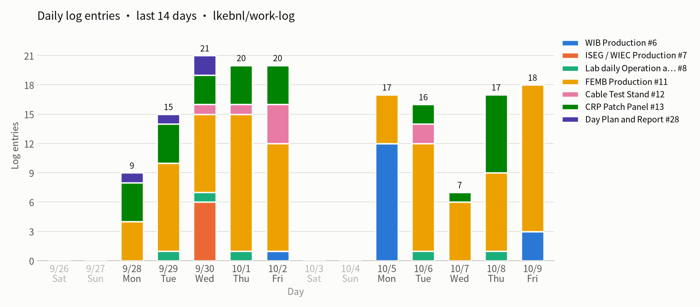
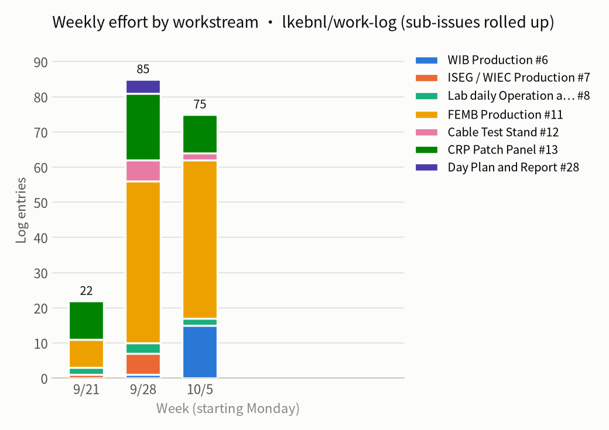

# Weekly report 2026-W41 (10-02 – 10-09)

- Window (New York): 2026-10-02 20:08 → 2026-10-09 21:48
- Issues with activity: 33 (opened 22, closed 23); comments: 75
- Source: issue comments and status events fetched by script, no AI; issue bodies not included

## Charts

## Workstreams

| Workstream | Comments | Opened | Closed | Issues with activity |
|---|---:|---:|---:|---|
| [WIB Production] #6 | 15 | 4 | 4 | #33 #58 #59 #60 #78 |
| [Lab daily Operation and Maintenance] #8 | 2 | 0 | 0 | #8 |
| [FEMB Production] #11 | 45 | 14 | 13 | #14 #51 #62 #63 #64 #65 #67 #44 #49 #73 #23 #68 #76 #27 #52 #61 #70 #71 #72 #77 #79 |
| [Cable Test Stand] #12 | 2 | 0 | 1 | #50 |
| [CRP Patch Panel] #13 | 11 | 4 | 5 | #57 #30 #66 #69 #74 |

## Closed this week

- #76 Clean the CTS Dewar (10-09, closed)
- #74 Train Students about the CRP Patch Panel QC (10-08, closed)
- #69 request to buy thumb screw (10-08, closed)
- #68 CE Test Plate (10-09, closed)
- #67 G06 CRP Patch Panel QC — Adaptor Board Installation (10-07, closed)
- #66 Label the Cables (10-08, closed)
- #65 G04 Disassembly Power Cable (10-07, closed)
- #64 G03 Assembly Power Cable (10-07, closed)
- #63 G02 Disassembly MiniSAS Cable (10-07, closed)
- #62 G01 Assembly MiniSAS Cable (10-06, closed)
- #61 Re-built the Test Environment of IOW (10-06, closed)
- #60 Components pick up  Record in Room 96 (10-06, closed)
- #59 Correction of Temperature Sensor [U42 U47 U64] (10-05, closed)
- #58 Hardware Correction of WIB Pulser Oscillation (10-05, closed)
- #57 visual inspection for Patch Panel (10-08, closed)
- #52 QR Code Plan (10-05, closed)
- #51 train cases (10-09, closed)
- #50 Cable Test 10062026 (10-07, closed)
- #49 update P4 inspection procedure at post-assembly checkout (10-05, closed)
- #44 Issue Case 01: P4 Data connector on BNL_FEMB_IO-1865-1K_00005 and BNL_FEMB_IO-1865-1K_00039 (10-08, closed)
- #33 Issue board 1750-1F-17 back from CERN, debug by Jack (10-05, closed)
- #30 pop-windows (10-08, closed)
- #27 Question: Why the data connection at Debug test setup always failed at LN2? (10-05, closed)

## Opened this week

- #79 FEMB Tracking (10-09)
- #78 Track for WIB (10-09)
- #77 Criteria for Checkout (10-09)
- #76 Clean the CTS Dewar (10-09)
- #74 Train Students about the CRP Patch Panel QC (10-08)
- #73 Issue Case 02: BNL_FEMB_IO-1865-1K_00039 (10-08)
- #72 LArASIC RMS Low, Pulse Normal (10-08)
- #71 LArASIC Defect (10-08)
- #70 Performance Evaluation Experience (10-08)
- #69 request to buy thumb screw (10-08)
- #68 CE Test Plate (10-08)
- #67 G06 CRP Patch Panel QC — Adaptor Board Installation (10-07)
- #66 Label the Cables (10-07)
- #65 G04 Disassembly Power Cable (10-07)
- #64 G03 Assembly Power Cable (10-07)
- #63 G02 Disassembly MiniSAS Cable (10-07)
- #62 G01 Assembly MiniSAS Cable (10-06)
- #61 Re-built the Test Environment of IOW (10-06)
- #60 Components pick up  Record in Room 96 (10-05)
- #59 Correction of Temperature Sensor [U42 U47 U64] (10-05)
- #58 Hardware Correction of WIB Pulser Oscillation (10-05)
- #57 visual inspection for Patch Panel (10-05)

## Open issues with no update for over 7 days

- #6 [WIB Production] (last updated 09-29)

- #7 [ISEG / WIEC Production]  (last updated 09-30)
  - #34 Pop-windows (last updated 09-30)

- #11 [FEMB Production] (last updated 09-29)
  - #55 Cable Bundle issue at CTS_1 (last updated 10-02)（← #14）
  - #20 check CR-RC Adapter Board (last updated 09-29)
  - #45 Test environment issue debug (last updated 10-01)（← #27）

- #12 [Cable Test Stand] (last updated 09-29)

- #13 [CRP Patch Panel] (last updated 09-30)
  - #48 Shanshan's review (last updated 10-02)

- #28 Day Plan and Report (last updated 09-30)

## Details

### [WIB Production] #6

#### #33 Issue board 1750-1F-17 back from CERN, debug by Jack · closed

- **10-05 10:01** · lkebnl · [comment](https://github.com/lkebnl/work-log/issues/33#issuecomment-5996035026)
  > perform QC test for this board 1750-1F-17
- **10-05 13:03** · lkebnl · [comment](https://github.com/lkebnl/work-log/issues/33#issuecomment-5999217061)
  > this board should correct the analog calibration part, completed
- **10-05 13:51** · lkebnl · [comment](https://github.com/lkebnl/work-log/issues/33#issuecomment-6000003384)
  > during the test, TCP always loss the link and cause failed to connect to server
- **10-05 15:04** · lkebnl · [comment](https://github.com/lkebnl/work-log/issues/33#issuecomment-6001171280)
  > since the UDP connector loss the cage, may the reason from the data updated faild at UDP side?
  > we should make it clear
- **10-05 15:06** · lkebnl · [comment](https://github.com/lkebnl/work-log/issues/33#issuecomment-6001208890)
  > seems single item QC pass after reconnect the UDP SFP module
- **10-05 17:21** · lkebnl · status: closed
- **10-05 18:45** · lkebnl · [comment](https://github.com/lkebnl/work-log/issues/33#issuecomment-6004719597)
  > QC Pass after repair

##### #58 Hardware Correction of WIB Pulser Oscillation · closed

- **10-05 17:46** · lkebnl · status: opened
- **10-05 17:47** · lkebnl · [comment](https://github.com/lkebnl/work-log/issues/58#issuecomment-6003674945)
  > [WIB_pulser_oscillation _03102025v1.pptx](https://github.com/user-attachments/files/33079358/WIB_pulser_oscillation._03102025v1.pptx)
  > [remove_4_7V_cap_04092025.pptx](https://github.com/user-attachments/files/33079357/remove_4_7V_cap_04092025.pptx)
- **10-05 17:48** · lkebnl · [comment](https://github.com/lkebnl/work-log/issues/58#issuecomment-6003694997)
  > for board 1750-1F-17
  > Remove C750
  > R360: 240 Ohm
  > R726: 1kOhm
- **10-05 17:48** · lkebnl · status: closed

##### #59 Correction of Temperature Sensor [U42 U47 U64] · closed

- **10-05 18:08** · lkebnl · status: opened
- **10-05 18:08** · lkebnl · [comment](https://github.com/lkebnl/work-log/issues/59#issuecomment-6004098452)
  > reference link
  > https://docs.google.com/presentation/d/1BjKl-dDhYrTF3CFvsCUn2lZXKy80aYeWBqd1fLxVZoY/edit?slide=id.p#slide=id.p
- **10-05 18:17** · lkebnl · [comment](https://github.com/lkebnl/work-log/issues/59#issuecomment-6004272605)
  > repair board 1750-1F-17
  > Pick up one CHA 7414-0 for U64
  > assembly new to U64
  > switch TOH at U64 to U42
  > switch CHA at U42 to U47
- **10-05 18:45** · lkebnl · [comment](https://github.com/lkebnl/work-log/issues/59#issuecomment-6004708756)
  > Test normal after repair
- **10-05 18:45** · lkebnl · status: closed

#### #60 Components pick up  Record in Room 96 · closed

- **10-05 18:09** · lkebnl · status: opened
- **10-05 18:11** · lkebnl · [comment](https://github.com/lkebnl/work-log/issues/60#issuecomment-6004143942)
  > repair board 1750-1F-17
  > Pick up one CHA 7414-0 for U64
- **10-06 11:27** · lkebnl · status: closed

#### #78 Track for WIB · open

- **10-09 09:52** · lkebnl · status: opened
- **10-09 09:53** · lkebnl · [comment](https://github.com/lkebnl/work-log/issues/78#issuecomment-6082318902)
  > Record based on present record and will be increased with test
- **10-09 09:57** · lkebnl · [comment](https://github.com/lkebnl/work-log/issues/78#issuecomment-6082390604)
  > 1750-1F-17, Back from CERN, Repaired in room 233, [J12 pin may discharge at ZYNQ side]
  > 1750-1F-22, Back from CERN, Repaired in room 233
  >
  > 1750-1F-10, 2 slot discharge work as debug test setup and cable test setup.  in room 213
- **10-09 10:30** · lkebnl · [comment](https://github.com/lkebnl/work-log/issues/78#issuecomment-6082965176)
  > 1750-1D-35, Back from CERN, Repaired in room 233

### [Lab daily Operation and Maintenance] #8

- **10-06 10:34** · lkebnl · [comment](https://github.com/lkebnl/work-log/issues/8#issuecomment-6018570841)
  > Talk with Andy, we will present our work about CRP Patch Panel on a Thursday electronics group meeting
- **10-08 14:57** · lkebnl · [comment](https://github.com/lkebnl/work-log/issues/8#issuecomment-6066935549)
  > Ubuntu Environment Configuration
  >
  > **Use Flameshot**: select a region, then annotate it with arrows, boxes, pen, blur or text, and copy or save the result.
  >
  > 1. Install: `sudo apt install flameshot`
  > 2. Free the Print key from the default screenshot tool:
  >    `gsettings set org.gnome.shell.keybindings show-screenshot-ui "[]"`
  > 3. Bind Print to Flameshot: Settings → Keyboard → Custom Shortcuts → `+`, set the command to `flameshot gui`, then press Print.
  >
  > **Wayland caveat:** check with `echo $XDG_SESSION_TYPE`. On Wayland, Flameshot may capture a black screen or ask for permission every time. To fix it, either log into "Ubuntu on Xorg" or install a newer Flameshot from Flatpak or Snap.
  >
  > **Alternatives:** Gradia (Flathub) works well on GNOME Wayland. Ksnip has more editing features.

### [FEMB Production] #11

#### #14 shifter for HD / VD FEMB 09232026 · open

- **10-05 10:02** · lkebnl · [comment](https://github.com/lkebnl/work-log/issues/14#issuecomment-5996053600)
  > Test FEMB BNL_FEMB_IO-1826-1K_00051
- **10-05 10:02** · lkebnl · [comment](https://github.com/lkebnl/work-log/issues/14#issuecomment-5996058961)
  > Wait for FEMB repair at IO
- **10-06 10:34** · lkebnl · [comment](https://github.com/lkebnl/work-log/issues/14#issuecomment-6018585906)
  > Receive the FEMB K39 from Ray, which repair the P4 connector issue.
  > will assembly into CE box and arrange the test
  > Assembly K39 and K12 for tested
- **10-08 12:36** · lkebnl · [comment](https://github.com/lkebnl/work-log/issues/14#issuecomment-6064538862)
  > Test boards BNL_FEMB_IO-1865-1K_00039 and BNL_FEMB_IO-1865-1K_00012
  > board_39 have non-linearity issue
  > board_12 pass the QC test
- **10-08 15:15** · lkebnl · [comment](https://github.com/lkebnl/work-log/issues/14#issuecomment-6067238184)
  > FEMB 1826-1L-61 sent to Ray for repair

##### #51 train cases · closed

- **10-07 14:55** · lkebnl · [comment](https://github.com/lkebnl/work-log/issues/51#issuecomment-6044693791)
  > prompt 
  >
  > Attached: photos of one assembly step of the [CRP Patch Panel QC] fixture, named IMG_xxxx.
  > Order and what each shows:
  >   IMG_aaaa – [what it shows / what the operator does]
  >   IMG_bbbb – [...]
  >   ...
  > Key facts: [part numbers, quantities, connector/port mapping, which ports stay open, cautions]
  >
  > Add this as "Part N · [procedure name]" to my existing deck
  > [deck link], keeping the same style:
  > - part divider slide (dark, photo on the right)
  > - a diagram slide if there is a mapping/wiring/orientation to explain
  > - one step per photo: photo on the left with orange callouts (circles/boxes,
  >   arrows, short labels on the key features), on the right "STEP xx / NN",
  >   a progress bar, a title, 3–4 short bullets, and an optional tip
  > - last step = "complete" slide (dark) with a ✓ final checklist
  > - a one-page quick reference: all photos in a grid with one-line captions
  > - footer "CRP Patch Panel QC · [procedure]", continue the page numbers
  > - English, concise; flag anything you inferred from the photos rather than
  >   from my description.
- **10-09 08:04** · lkebnl · status: closed

###### #62 G01 Assembly MiniSAS Cable · closed

- **10-06 18:16** · lkebnl · status: opened
- **10-06 18:17** · lkebnl · [comment](https://github.com/lkebnl/work-log/issues/62#issuecomment-6026472180)
  > [MiniSAS_Installation_Guide.pdf](https://github.com/user-attachments/files/33130023/MiniSAS_Installation_Guide.pdf)
- **10-06 20:07** · lkebnl · status: closed

###### #63 G02 Disassembly MiniSAS Cable · closed

- **10-07 10:54** · lkebnl · status: opened
- **10-07 11:31** · lkebnl · [comment](https://github.com/lkebnl/work-log/issues/63#issuecomment-6041162796)
  > Manual for MiniSAS Connector Removal
  >
  > [MiniSAS Connector Removal.pdf](https://github.com/user-attachments/files/33164589/MiniSAS.Connector.Removal.pdf)
- **10-07 11:31** · lkebnl · status: closed

###### #64 G03 Assembly Power Cable · closed

- **10-07 11:17** · lkebnl · status: opened
- **10-07 11:57** · lkebnl · [comment](https://github.com/lkebnl/work-log/issues/64#issuecomment-6041646633)
  > Assembly Power Cable
  >
  > [Power_Connector_Installation_and_Removal.pptx](https://github.com/user-attachments/files/33165655/Power_Connector_Installation_and_Removal.pptx)
- **10-07 11:58** · lkebnl · status: closed

###### #65 G04 Disassembly Power Cable · closed

- **10-07 11:18** · lkebnl · status: opened
- **10-07 11:19** · lkebnl · [comment](https://github.com/lkebnl/work-log/issues/65#issuecomment-6040922481)
  > Manual for Power Connector Removal
  > [Power Connector Removal.pdf](https://github.com/user-attachments/files/33163948/Power.Connector.Removal.pdf)
- **10-07 11:19** · lkebnl · status: closed

###### #67 G06 CRP Patch Panel QC — Adaptor Board Installation · closed

- **10-07 14:00** · lkebnl · status: opened
- **10-07 14:00** · lkebnl · [comment](https://github.com/lkebnl/work-log/issues/67#issuecomment-6043773497)
  > Step 02
  >
  > the page 1 to 12 is detail instruction
  > the page 13 is summary and used as the pop-windows on Patch Panel QC
  >
  > [CRP Patch Panel QC — Adaptor Board Installation.pdf](https://github.com/user-attachments/files/33170195/CRP.Patch.Panel.QC.Adaptor.Board.Installation.pdf)
- **10-07 14:00** · lkebnl · status: closed

##### #44 Issue Case 01: P4 Data connector on BNL_FEMB_IO-1865-1K_00005 and BNL_FEMB_IO-1865-1K_00039 · closed

- **10-08 12:39** · lkebnl · status: closed

###### #49 update P4 inspection procedure at post-assembly checkout · closed

- **10-05 11:48** · lkebnl · [comment](https://github.com/lkebnl/work-log/issues/49#issuecomment-5997964311)
  > [Attention to the coming IO-1865-1L assembly jobs .msg](https://github.com/user-attachments/files/33066181/Attention.to.the.coming.IO-1865-1L.assembly.jobs.msg)
- **10-05 11:48** · lkebnl · status: closed

##### #73 Issue Case 02: BNL_FEMB_IO-1865-1K_00039 · open

- **10-08 12:31** · lkebnl · status: opened
- **10-08 12:31** · lkebnl · [comment](https://github.com/lkebnl/work-log/issues/73#issuecomment-6064452187)
  > Non-linearity found during the QC
- **10-08 12:34** · lkebnl · [comment](https://github.com/lkebnl/work-log/issues/73#issuecomment-6064509045)
  > during review the result test at 09292025
  > this board failed at rms during the machine judgement for the criteria and pass after human review
  > the linearity issue can be found after review carefully, but was not recognize by machine criteria. this year, we update the criteria about the non-linearity calibration test
  >
  > 
  >
  > **https://www.phy.bnl.gov/twister/static/cetsdata/femb/bnl/Time_2025_09/29_16_24_27_CTS_BNL_S0BNL_FEMB_IO-1865-1K_00039_S1BNL_FEMB_IO-1865-1K_00020_LN_QC/FEMBBNL_FEMB_IO-1865-1K_00039_S0/report_FEMB_0_t6_P_S0.md**
- **10-09 09:41** · lkebnl · [comment](https://github.com/lkebnl/work-log/issues/73#issuecomment-6082107886)
  > 执行全谱DAC全Gain线性分析
  > confirm this issue
- **10-09 10:47** · lkebnl · [comment](https://github.com/lkebnl/work-log/issues/73#issuecomment-6083264609)
  > channel_04, channel_17
- **10-09 10:48** · lkebnl · [comment](https://github.com/lkebnl/work-log/issues/73#issuecomment-6083288260)
  > Debug flow:
  > install into test setup
  > startup, warm checkout to confirm the connection
  > immersed by LN2
  > startup, cold checkout to confirm the connection
  > implement the QC debug item
  > upload the data
  > execute the analysis
- **10-09 11:21** · lkebnl · [comment](https://github.com/lkebnl/work-log/issues/73#issuecomment-6083853532)
  > 
  >
  > 
- **10-09 11:21** · lkebnl · [comment](https://github.com/lkebnl/work-log/issues/73#issuecomment-6083865180)
  > 
  >
  > 
- **10-09 11:31** · lkebnl · [comment](https://github.com/lkebnl/work-log/issues/73#issuecomment-6084025894)
  > need to Replace Chip U7 [009-05069] and U17 [009-06584]
- **10-09 11:45** · lkebnl · [comment](https://github.com/lkebnl/work-log/issues/73#issuecomment-6084252916)
  > send to Ray

#### #23 Setup for University of Mississippi · open

- **10-05 13:36** · lkebnl · [comment](https://github.com/lkebnl/work-log/issues/23#issuecomment-5999753402)
  > Mississippi will visit BNL at Nov
- **10-07 10:43** · lkebnl · [comment](https://github.com/lkebnl/work-log/issues/23#issuecomment-6040400615)
  > make seal block for CTS
  >
  > 

##### #68 CE Test Plate · closed

- **10-08 10:27** · lkebnl · status: opened
- **10-08 10:28** · lkebnl · [comment](https://github.com/lkebnl/work-log/issues/68#issuecomment-6062083322)
  > plate_08
  > include test plate, test blocks for top and bottom
- **10-08 10:28** · lkebnl · [comment](https://github.com/lkebnl/work-log/issues/68#issuecomment-6062086600)
  > Cable Bundle Number_08
- **10-08 12:23** · lkebnl · [comment](https://github.com/lkebnl/work-log/issues/68#issuecomment-6064307622)
  > 
- **10-09 08:05** · lkebnl · status: closed

##### #76 Clean the CTS Dewar · closed

- **10-09 08:09** · lkebnl · status: opened
- **10-09 08:13** · lkebnl · [comment](https://github.com/lkebnl/work-log/issues/76#issuecomment-6080652391)
  > 1. Set as IMMERSE Mode
  > 
  >
  > 3. Scoop out the liquid nitrogen
  > 
  >
  > 5. When the LN2 is not easy to scoop, set back to idle
  > 6. Connect the input port with compress air source via the cable
  > 
  >
  > 8. Close the lid of CTS and seal the Chamber
  > 9. Open the compress air and blow for the whole weekend
  > 
  >
  > will blow at the weekend
- **10-09 15:53** · lkebnl · status: closed

#### #27 Question: Why the data connection at Debug test setup always failed at LN2? · closed

- **10-05 17:20** · lkebnl · status: closed
- **10-09 13:40** · lkebnl · [comment](https://github.com/lkebnl/work-log/issues/27#issuecomment-6086102314)
  > Ray have replasce the two chips
  > U17 SN
  > U3 SN
  >
  > Replaced U3: 003-01405
  > Replaced U17: 004-01190
- **10-09 13:41** · lkebnl · [comment](https://github.com/lkebnl/work-log/issues/27#issuecomment-6086117932)
  > for the repaired board, we should perform the whole test cycle like new board
  > 1. take pictures, choose repair mode
  > 2. checkout test
  > 3. assembly into the CE box
  > 4. perform QC test

#### #52 QR Code Plan · closed

- **10-05 17:20** · lkebnl · [comment](https://github.com/lkebnl/work-log/issues/52#issuecomment-6003156401)
  > Shanshan think it is too complex and no need to print this SN number on foam box. we accept this decision
- **10-05 17:20** · lkebnl · status: closed

#### #61 Re-built the Test Environment of IOW · closed

- **10-06 10:47** · lkebnl · status: opened
- **10-06 10:48** · lkebnl · [comment](https://github.com/lkebnl/work-log/issues/61#issuecomment-6018849511)
  > IOW have updated their test environment
  > Hariom request to help them to build the test setup
- **10-06 10:51** · lkebnl · [comment](https://github.com/lkebnl/work-log/issues/61#issuecomment-6018893572)
  > purpose:
  > 1. install the python package for power supply
  > 2. install all python package for QC data analysis
  > 3. install Desktop launcher at their test site
  > 4. based on this lesson, record the detail procedure in this issue case to provide environment build up procedure, which can be reused easily in each test setup, include Mississippi
- **10-06 10:52** · lkebnl · [comment](https://github.com/lkebnl/work-log/issues/61#issuecomment-6018919958)
  > resources：
  > https://drive.google.com/drive/folders/1eLTqghM3CPQdZQOZYXtBAwsWFctEf6Zl
  >
  > Environment:
  > https://docs.google.com/presentation/d/1b_B7Mgzb9hDgCoA-8-KNcejSv5e1AXL3dKIutpdinvU/edit?slide=id.g3da8ef2e8ae_0_27#slide=id.g3da8ef2e8ae_0_27
  >
  > [requirements.txt](https://github.com/user-attachments/files/33112127/requirements.txt)
  >
  > Desktop Launcher
  > https://docs.google.com/document/d/1HP4_vixNrpMrGA8HoOpVgifntc4j3j01zev8aq-OVE8/edit?tab=t.0#heading=h.2z1hid64wqjs
- **10-06 12:47** · lkebnl · [comment](https://github.com/lkebnl/work-log/issues/61#issuecomment-6021052605)
  > the zoom can not do the remote control once one side open in the web observer
  > install zoom app
- **10-06 13:12** · lkebnl · [comment](https://github.com/lkebnl/work-log/issues/61#issuecomment-6021493756)
  > zoom screen abnormal issue:
  >
  > Open a terminal (Ctrl+Alt+T)
  > [1:04 PM]paste this line
  > sudo sed -i 's/^#\?\s*WaylandEnable=.*/WaylandEnable=false/' /etc/gdm3/custom.conf && sudo reboot
- **10-06 14:22** · lkebnl · [comment](https://github.com/lkebnl/work-log/issues/61#issuecomment-6022708880)
  > sudo apt install python3-tk
- **10-06 14:23** · lkebnl · [comment](https://github.com/lkebnl/work-log/issues/61#issuecomment-6022726594)
  > sudo apt install python3-pil.imagetk
- **10-06 14:45** · lkebnl · [comment](https://github.com/lkebnl/work-log/issues/61#issuecomment-6023103781)
  > use AI and our launcher document to build desktop launcher for ISU test setup
  > now, all have been done and wait for the test feedback from them
- **10-06 14:45** · lkebnl · status: closed
- **10-06 15:26** · lkebnl · [comment](https://github.com/lkebnl/work-log/issues/61#issuecomment-6023846322)
  > syn the ssh-key
  >
  > ssh-keygen -f ~/.ssh/konwn_hosts -R 192.168.121.123 # to refresh the pub file
  > ssh-keygen -t ed25519
  > cat ~/.ssh/id_ed25519.pub
  > ssh-copy-id -i ~/.ssh/id_ed25519.pub root@192.168.121.123 # password fpga
- **10-08 08:29** · lkebnl · [comment](https://github.com/lkebnl/work-log/issues/61#issuecomment-6059887462)
  > cd ~/Documents/BNL_CE_WIB_SW_QC
  > pip install matplotlib numpy pandas fpdf reportlab colorama tabulate --break-system-packages
- **10-09 16:09** · lkebnl · [comment](https://github.com/lkebnl/work-log/issues/61#issuecomment-6088433041)
  > IOW change the account of the PC, but they can not correct the top path, just help them to correct it
  > 
- **10-09 16:30** · lkebnl · [comment](https://github.com/lkebnl/work-log/issues/61#issuecomment-6088743323)
  > the reason is that they have do some changes on the account and environment and miss one configuration. after install this library, it works
  > python3 -m pip install --user --break-system-packages scipy

#### #70 Performance Evaluation Experience · open

- **10-08 12:25** · lkebnl · status: opened

##### #71 LArASIC Defect · open

- **10-08 12:26** · lkebnl · status: opened

###### #72 LArASIC RMS Low, Pulse Normal · open

- **10-08 12:26** · lkebnl · status: opened

#### #77 Criteria for Checkout · open

- **10-09 09:30** · lkebnl · status: opened
- **10-09 09:31** · lkebnl · [comment](https://github.com/lkebnl/work-log/issues/77#issuecomment-6081919112)
  > during our test, board 46 shows issue criteria at pulse response, we need to improve with it

#### #79 FEMB Tracking · open

- **10-09 09:58** · lkebnl · status: opened
- **10-09 09:58** · lkebnl · [comment](https://github.com/lkebnl/work-log/issues/79#issuecomment-6082411343)
  > Record based present information at 216, may increase during our test
- **10-09 10:00** · lkebnl · [comment](https://github.com/lkebnl/work-log/issues/79#issuecomment-6082432652)
  > Version 1826-1K
  > 1826-1K-31 room-216 at cable test setup, used as backup tested FEMB

### [Cable Test Stand] #12

#### #50 Cable Test 10062026 · closed

- **10-06 11:48** · lkebnl · [comment](https://github.com/lkebnl/work-log/issues/50#issuecomment-6020000110)
  > Lou test 3 Samtec Cable
- **10-06 17:14** · lkebnl · [comment](https://github.com/lkebnl/work-log/issues/50#issuecomment-6025571983)
  > Lou test the rest, all cable in this batch is done
- **10-07 10:30** · lkebnl · status: closed

### [CRP Patch Panel] #13

#### #22 slides report for CRP Patch Panel Test Stand · closed (no update in this window)

##### #57 visual inspection for Patch Panel · closed

- **10-05 11:49** · lkebnl · status: opened
- **10-06 11:06** · lkebnl · [comment](https://github.com/lkebnl/work-log/issues/57#issuecomment-6019188975)
  > Build new google account [lkebnl216] to get more google drive
  >
  > Take Pictures:
- **10-06 17:01** · lkebnl · [comment](https://github.com/lkebnl/work-log/issues/57#issuecomment-6025375809)
  > 
- **10-08 17:16** · lkebnl · status: closed

#### #30 pop-windows · closed

- **10-08 14:44** · lkebnl · status: closed

#### #66 Label the Cables · closed

- **10-07 12:06** · lkebnl · status: opened
- **10-07 12:07** · lkebnl · [comment](https://github.com/lkebnl/work-log/issues/66#issuecomment-6041830184)
  > to convenient tester, we label all the cables, so that they can be inserted into corresponding ports
- **10-08 11:36** · lkebnl · status: closed

#### #69 request to buy thumb screw · closed

- **10-08 11:13** · lkebnl · status: opened
- **10-08 11:14** · lkebnl · [comment](https://github.com/lkebnl/work-log/issues/69#issuecomment-6062987447)
  > buy some M3 thumb screw for CRP Patch Panel test plate
  > Include 6 pcs for the data cable clamps [0.7 inch],12 pcs for the adapter boards [0.5 inch] and 2 pcs for fixing the patch panel [1 inch]
- **10-08 17:15** · lkebnl · [comment](https://github.com/lkebnl/work-log/issues/69#issuecomment-6069201485)
  > 
- **10-08 17:23** · lkebnl · [comment](https://github.com/lkebnl/work-log/issues/69#issuecomment-6069326158)
  > Shanshan have provide the screws
  > after talk, for the screw used to fix the adapter boards, it is better to use the past small screw, which is narrow and eailier to install
- **10-08 17:24** · lkebnl · status: closed

#### #74 Train Students about the CRP Patch Panel QC · closed

- **10-08 14:47** · lkebnl · status: opened
- **10-08 14:48** · lkebnl · [comment](https://github.com/lkebnl/work-log/issues/74#issuecomment-6066768466)
  > completed train with our whole procedure and instruction manual
- **10-08 14:48** · lkebnl · [comment](https://github.com/lkebnl/work-log/issues/74#issuecomment-6066771652)
  > hand over the documents to them
- **10-08 14:49** · lkebnl · [comment](https://github.com/lkebnl/work-log/issues/74#issuecomment-6066783964)
  > during the test, we find the patch panel assembly by us have some small assembly issue and will return back to Ray to refill the holes
- **10-08 14:54** · lkebnl · [comment](https://github.com/lkebnl/work-log/issues/74#issuecomment-6066884510)
  > 
  >
  > Ray have repaired one Patch Panel
  > also do a inspection for the 3 of 20 production patch panel
- **10-08 14:59** · lkebnl · status: closed
- **10-08 15:20** · lkebnl · [comment](https://github.com/lkebnl/work-log/issues/74#issuecomment-6067327262)
  > Too many ice in CTS_2, need to be clean
