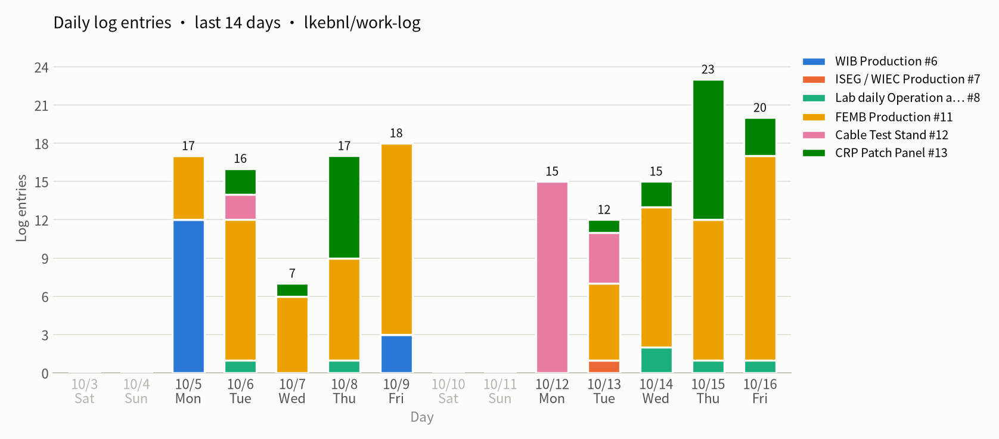
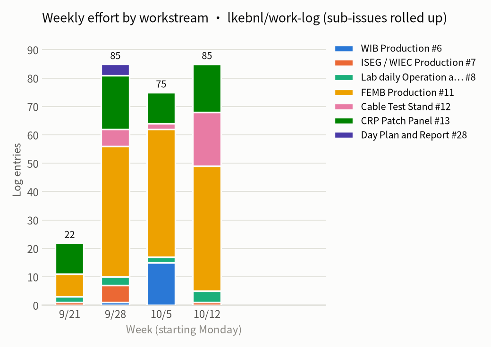

# Weekly report 2026-W42 (10-09 – 10-16)

- Window (New York): 2026-10-09 21:48 → 2026-10-16 18:41
- Issues with activity: 32 (opened 21, closed 19); comments: 85
- Source: issue comments and status events fetched by script, no AI; issue bodies not included

## Charts

## Workstreams

| Workstream | Comments | Opened | Closed | Issues with activity |
|---|---:|---:|---:|---|
| [WIB Production] #6 | 0 | 1 | 0 | #100 |
| [ISEG / WIEC Production]  #7 | 1 | 1 | 1 | #34 #96 |
| [Lab daily Operation and Maintenance] #8 | 4 | 1 | 1 | #86 |
| [FEMB Production] #11 | 44 | 8 | 7 | #14 #55 #73 #84 #97 #45 #79 #92 #91 #93 #94 #95 #77 #99 #61 |
| [Cable Test Stand] #12 | 19 | 5 | 6 | #54 #80 #81 #82 #83 #85 |
| [CRP Patch Panel] #13 | 17 | 5 | 4 | #13 #48 #87 #90 #88 #89 #98 |

## Closed this week

- #98 BNL/CRU-PP/IO-1889-1B/00021 (10-16, closed)
- #97 CE box one CE box cover [0010] (10-16, closed)
- #95 the study of crosstalk caused by external control signal (10-16, closed)
- #93 Instruction pop-windows (10-16, closed)
- #91 BNL/FEMB/I0-1865-1K/00010 (10-16, closed)
- #90 BNL/CRU-PP/IO-1889-1A/00012 (10-15, closed)
- #89 BNL/CRU-PP/IO-1889-1B/00002 (10-15, closed)
- #86 10142026 Delivery task for Manhong  (10-16, closed)
- #85 Verify the other cable in test setup (10-13, closed)
- #83 issue mode 02 cable bundle of CTS_1 (10-12, closed)
- #82 cable issue mode 01 (10-12, closed)
- #81 Debug Setup for MiniSAS Cable (10-12, closed)
- #80 Understand of the Cable internal connection (10-12, closed)
- #73 Issue Case 02: BNL_FEMB_IO-1865-1K_00039 (10-16, closed)
- #61 Re-built the Test Environment of IOW (10-16, closed)
- #55 Cable Bundle issue at CTS_1 (10-14, closed)
- #54 Setup Cable Corrosion (10-12, closed)
- #48 Shanshan's review (10-13, closed)
- #34 Pop-windows (10-13, closed)

## Opened this week

- #100 Shifter Board List 10162026 (10-16)
- #99 Test Site Status (10-16)
- #98 BNL/CRU-PP/IO-1889-1B/00021 (10-16)
- #97 CE box one CE box cover [0010] (10-16)
- #96 update the test and verification to improve the report format (10-16)
- #95 the study of crosstalk caused by external control signal (10-16)
- #94 Development Record and Improvement (10-16)
- #93 Instruction pop-windows (10-16)
- #92 202610 BNL Test Site (10-15)
- #91 BNL/FEMB/I0-1865-1K/00010 (10-15)
- #90 BNL/CRU-PP/IO-1889-1A/00012 (10-15)
- #89 BNL/CRU-PP/IO-1889-1B/00002 (10-15)
- #88 BNL/CRU-PP/IO-1889-1B/00003 (10-14)
- #87 Track for Patch Panel [102026] (10-14)
- #86 10142026 Delivery task for Manhong  (10-14)
- #85 Verify the other cable in test setup (10-13)
- #84 Issue Case 03: BNL_FEMB_IO-1826-1L_00051 (10-13)
- #83 issue mode 02 cable bundle of CTS_1 (10-12)
- #82 cable issue mode 01 (10-12)
- #81 Debug Setup for MiniSAS Cable (10-12)
- #80 Understand of the Cable internal connection (10-12)

## Open issues with no update for over 7 days

- **[WIB Production] #6**
  - #78 Track for WIB (last updated 10-09)

- #7 [ISEG / WIEC Production]  (last updated 09-30)

- #8 [Lab daily Operation and Maintenance] (last updated 10-08)

- **[FEMB Production] #11**
  - #20 check CR-RC Adapter Board (last updated 09-29)
  - #70 Performance Evaluation Experience (last updated 10-08)（← #94）
    - #71 LArASIC Defect (last updated 10-08)
      - #72 LArASIC RMS Low, Pulse Normal (last updated 10-08)
  - #23 Setup for University of Mississippi (last updated 10-07)（← #99）

- #28 Day Plan and Report (last updated 09-30)

## Details

### [WIB Production] #6

#### #100 Shifter Board List 10162026 · open

- **10-16 14:13** · lkebnl · status: opened

### [ISEG / WIEC Production]  #7

#### #34 Pop-windows · closed

- **10-13 15:09** · lkebnl · status: closed
- **10-13 16:39** · lkebnl · [comment](https://github.com/lkebnl/work-log/issues/34#issuecomment-6154745115)
  > new pop-windows
  > [ISEG_Module_QC_SOP_v3.pdf](https://github.com/user-attachments/files/33405592/ISEG_Module_QC_SOP_v3.pdf)

#### #96 update the test and verification to improve the report format · open

- **10-16 08:53** · lkebnl · status: opened

### [Lab daily Operation and Maintenance] #8

#### #86 10142026 Delivery task for Manhong  · closed

- **10-14 08:55** · lkebnl · status: opened
- **10-14 08:55** · lkebnl · [comment](https://github.com/lkebnl/work-log/issues/86#issuecomment-6168834428)
  > Manhong will take 2 boards to CERN
- **10-14 08:55** · lkebnl · [comment](https://github.com/lkebnl/work-log/issues/86#issuecomment-6168839540)
  > one board should replace the 6 power connectors
- **10-15 17:27** · lkebnl · [comment](https://github.com/lkebnl/work-log/issues/86#issuecomment-6202638618)
  > BNL/FEMB/I0-1865-1K/00010 #91
- **10-16 12:55** · lkebnl · [comment](https://github.com/lkebnl/work-log/issues/86#issuecomment-6220458674)
  > CRP Patch Panel SN:
  >
  > 01: BNL/CRU-PP/IO-1889-1B/00021 #98 
  > 02: BNL/CRU-PP/IO-1889-1B/00002 #89
- **10-16 12:55** · lkebnl · status: closed

### [FEMB Production] #11

#### #14 shifter for HD / VD FEMB 09232026 · open

- **10-15 16:27** · lkebnl · [comment](https://github.com/lkebnl/work-log/issues/14#issuecomment-6201593832)
  > Lingyun Test boards BNL_FEMB_IO-1826-1L_00051 and BNL_FEMB_IO-1826-1L_00061
  > during the test, the ice brock the dewar
  > we have to move FEMB out, the bottom FEMB become wet and polluted by ice
  > BNL_FEMB_IO-1826-1L_00061 pass the QC
  > BNL_FEMB_IO-1826-1L_00051 failed the test for one channel polluted. tomorrow we will test it again
- **10-16 09:00** · lkebnl · [comment](https://github.com/lkebnl/work-log/issues/14#issuecomment-6216051728)
  > should clear the CTS_1
  >
  > Reference: #76 
  >
  > Record the time: 10162026, when we do the next clean, we can understand the period to clean the dewar at BNL Test Site
  > I remember the last time to clean is 3 month ago, but not confirm
- **10-16 12:47** · lkebnl · [comment](https://github.com/lkebnl/work-log/issues/14#issuecomment-6220333478)
  > Lingyun Test boards BNL_FEMB_IO-1865-1K_00039, pass the QC

##### #55 Cable Bundle issue at CTS_1 · closed

- **10-13 09:04** · lkebnl · [comment](https://github.com/lkebnl/work-log/issues/55#issuecomment-6146188371)
  > https://github.com/lkebnl/work-log/issues/83
  >
  > this is solution, we need replace the bottom cold data cable
- **10-14 12:09** · lkebnl · [comment](https://github.com/lkebnl/work-log/issues/55#issuecomment-6172765505)
  > Repair method
- **10-14 12:10** · lkebnl · [comment](https://github.com/lkebnl/work-log/issues/55#issuecomment-6172780817)
  > how to make cable bundle:
  > Assembly steps
  >
  > 1. Prepare and inspect. Lay out both harnesses. There are two types: one goes to the WIB top slot and one to the bottom slot. Their branches are labeled T and B.
  > 2. Check breakout length. The breakout point is where the top-slot and bottom-slot harnesses split. It sits about 20 cm from the connector end; tape it so it stays in place.
  > 3. Bundle. Gather the twisted pairs and the braided-sleeve cable into one bundle, taping it at intervals.
  > 4. Base wrap and foam tube. Build a smooth tape base layer at the feedthrough position, then snap the slit foam tube over it.
  > 5. Outer wrap and end finish. Wrap the foam tightly and finish both ends with no exposed wire, so you end up with a uniform clamping cylinder.
  > 6. Pre-fit the clamp block. Close the two halves around the foam section. Check that the WARM and COLD faces match the installation side.
  > 7. Protect the connector end. Tape the tail of the latching connector, fit the yellow pin cover, and add the labels.
  > 8. Tighten. Tighten the two cap screws alternately with a 7/64" hex key, clamping the foam firmly without crushing it.
  > 9. Inspect. Check orientation, tightness, end finish, labels and pin covers.
- **10-14 14:08** · lkebnl · [comment](https://github.com/lkebnl/work-log/issues/55#issuecomment-6175053823)
  > [Cable Bundle Assembly.pptx](https://github.com/user-attachments/files/33450231/Cable.Bundle.Assembly.pptx)
- **10-14 14:10** · lkebnl · [comment](https://github.com/lkebnl/work-log/issues/55#issuecomment-6175083348)
  > will be tested to verify
- **10-14 14:10** · lkebnl · status: closed

##### #73 Issue Case 02: BNL_FEMB_IO-1865-1K_00039 · closed

- **10-15 13:02** · lkebnl · [comment](https://github.com/lkebnl/work-log/issues/73#issuecomment-6197696882)
  > repaired
  > Replace U7 to [004-01185]
  > Replace U17 to [004-01191]
- **10-15 13:18** · lkebnl · [comment](https://github.com/lkebnl/work-log/issues/73#issuecomment-6197990339)
  > take pictures
- **10-15 13:18** · lkebnl · [comment](https://github.com/lkebnl/work-log/issues/73#issuecomment-6197992760)
  > checkout test pass
- **10-16 12:15** · lkebnl · [comment](https://github.com/lkebnl/work-log/issues/73#issuecomment-6219735580)
  > QC pass
- **10-16 12:15** · lkebnl · status: closed

##### #84 Issue Case 03: BNL_FEMB_IO-1826-1L_00051 · open

- **10-13 09:06** · lkebnl · status: opened
- **10-13 10:51** · lkebnl · [comment](https://github.com/lkebnl/work-log/issues/84#issuecomment-6148323404)
  > **Description**
  > Channel 75 exhibits elevated noise RMS relative to the channel average when operated in LN2. This was previously classified as a weak but acceptable channel. Recent cold tests show the deviation has become significantly more pronounced, prompting a dedicated debug test.
  >
  > If you have the numbers (e.g., RMS on ch75 vs. average, earlier vs. recent), adding them in one clause would make the “became serious” claim concrete.
- **10-13 10:53** · lkebnl · [comment](https://github.com/lkebnl/work-log/issues/84#issuecomment-6148369929)
  > leakage current = 500 pA
  > 
- **10-13 10:53** · lkebnl · [comment](https://github.com/lkebnl/work-log/issues/84#issuecomment-6148379950)
  > leakage current = 1 nA
  >
  > 
- **10-13 10:56** · lkebnl · [comment](https://github.com/lkebnl/work-log/issues/84#issuecomment-6148429644)
  > need to replace U19 [004-06685]
- **10-13 10:57** · lkebnl · [comment](https://github.com/lkebnl/work-log/issues/84#issuecomment-6148448800)
  > since Ray is not at office today, the board will be replaced tomorrow
- **10-15 13:18** · lkebnl · [comment](https://github.com/lkebnl/work-log/issues/84#issuecomment-6197995957)
  > Repaired
  > Replace U19 as [004-01157]
- **10-15 13:18** · lkebnl · [comment](https://github.com/lkebnl/work-log/issues/84#issuecomment-6197998461)
  > take picture
- **10-15 13:18** · lkebnl · [comment](https://github.com/lkebnl/work-log/issues/84#issuecomment-6198000457)
  > checkout pass
- **10-15 14:15** · lkebnl · [comment](https://github.com/lkebnl/work-log/issues/84#issuecomment-6199111826)
  > assembly into CE box
  > one CE box cover [0010] have issue on screw:
  >
  > 
  >
  > compared with normal
  >
  > 
- **10-16 15:16** · lkebnl · [comment](https://github.com/lkebnl/work-log/issues/84#issuecomment-6222914813)
  > during the test, the channel_93 still shows issue
  > but when we disassembly the CRRC adapter board, the channel shows normal
  > will debug

#### #19 CE Box · closed (no update in this window)

##### #97 CE box one CE box cover [0010] · closed

- **10-16 09:10** · lkebnl · status: opened
- **10-16 09:11** · lkebnl · [comment](https://github.com/lkebnl/work-log/issues/97#issuecomment-6216244236)
  > assembly into CE box one CE box cover [0010] have issue on screw:
  >
  > 
  >
  > compared with normal
  >
  > 
- **10-16 09:11** · lkebnl · status: closed
- **10-16 11:22** · lkebnl · [comment](https://github.com/lkebnl/work-log/issues/97#issuecomment-6218723805)
  > have talk with Manhong, he think it may not the lastest one and will check the record and report it

#### #27 Question: Why the data connection at Debug test setup always failed at LN2? · closed (no update in this window)

##### #45 Test environment issue debug · open

- **10-15 11:12** · lkebnl · [comment](https://github.com/lkebnl/work-log/issues/45#issuecomment-6195431643)
  > 
  > closed the printer
- **10-15 11:28** · lkebnl · [comment](https://github.com/lkebnl/work-log/issues/45#issuecomment-6195786994)
  > noise is not from printer, also not from cell phone
  >
  > 

#### #79 FEMB Tracking · open

- **10-14 09:52** · lkebnl · [comment](https://github.com/lkebnl/work-log/issues/79#issuecomment-6169962734)
  > one possible design:
  > set in gmail, once one board complete QC, the gmail will send info to github and build a issue case for this board, so that could track it automatic

##### #92 202610 BNL Test Site · open

- **10-15 12:45** · lkebnl · status: opened

###### #91 BNL/FEMB/I0-1865-1K/00010 · closed

- **10-15 12:42** · lkebnl · status: opened
- **10-15 12:43** · lkebnl · [comment](https://github.com/lkebnl/work-log/issues/91#issuecomment-6197303580)
  > Result: https://www.phy.bnl.gov/twister/cets/femb/IO-1865-1K/00010/
  >
  > will send to CERN
- **10-16 14:03** · lkebnl · status: closed

#### #93 Instruction pop-windows · closed

- **10-16 08:30** · lkebnl · status: opened
- **10-16 08:32** · lkebnl · [comment](https://github.com/lkebnl/work-log/issues/93#issuecomment-6215567276)
  > improve the disassembly instruction of HD FEMB
  > 1. the foam box should be updated, which is larger than normal
  > 2. should highlight the terminator installation and ask tester check it again
  >
  > 
  >
  > 4. the HD FEMB don't need the clamps and the instruction should be updated and corrected
  >
  > 
- **10-16 09:22** · lkebnl · [comment](https://github.com/lkebnl/work-log/issues/93#issuecomment-6216449341)
  > should also highlight the clamps after disassembly the VD FEMB board, which people easy to forget to install it back
  >
  > 
- **10-16 12:36** · lkebnl · status: closed

#### #94 Development Record and Improvement · open

- **10-16 08:47** · lkebnl · status: opened

##### #95 the study of crosstalk caused by external control signal · closed

- **10-16 08:50** · lkebnl · status: opened
- **10-16 08:50** · lkebnl · [comment](https://github.com/lkebnl/work-log/issues/95#issuecomment-6215879549)
  > in signal path of the data cable, the analog path is side near a external control path.
  > in the firmware, once enable the external control signal, it can not closed
  > thus, it cause the crosstalk and raise noise on analog path
  >
  > [the study of crosstalk caused by external control signal.pdf](https://github.com/user-attachments/files/33546480/the.study.of.crosstalk.caused.by.external.control.signal.pdf)
- **10-16 08:51** · lkebnl · status: closed

##### #77 Criteria for Checkout · open

- **10-14 16:12** · lkebnl · [comment](https://github.com/lkebnl/work-log/issues/77#issuecomment-6177400446)
  > evaluate the checkout report from our 44 1826-1L FEMB board
  > summary the distribution of the good channel
  > make plot
  > find that, for the channel performance, all parameters are in 5 sigma
  > for the power distribution, most parameter are in 5 sigma, 2 test out of 5 sigma. but all in 7 sigma.
  > therefore, we will set 5 sigma and 7 sigma based on our small production set as production thresold
- **10-14 16:14** · lkebnl · [comment](https://github.com/lkebnl/work-log/issues/77#issuecomment-6177433723)
  > [FEMB_QC_Criteria_Report.pdf](https://github.com/user-attachments/files/33457047/FEMB_QC_Criteria_Report.pdf)
- **10-14 16:16** · lkebnl · [comment](https://github.com/lkebnl/work-log/issues/77#issuecomment-6177470495)
  > 
  >
  > 
  >
  > 
- **10-14 16:28** · lkebnl · [comment](https://github.com/lkebnl/work-log/issues/77#issuecomment-6177748149)
  > in the past, we don't do the Statistical work for these distribution, thus, the thresold just use a general ratio.
  > with this result, we can do a precise thresold
  > examine by the board 46, which can not find the high pulse response by ratio thresold, but can be catched by sigma thresold
- **10-14 16:33** · lkebnl · [comment](https://github.com/lkebnl/work-log/issues/77#issuecomment-6177851710)
  > 
- **10-14 16:34** · lkebnl · [comment](https://github.com/lkebnl/work-log/issues/77#issuecomment-6177857003)
  > 

#### #99 Test Site Status · open

- **10-16 10:39** · lkebnl · status: opened

##### #61 Re-built the Test Environment of IOW · closed

- **10-16 10:41** · lkebnl · status: reopened
- **10-16 10:41** · lkebnl · [comment](https://github.com/lkebnl/work-log/issues/61#issuecomment-6217936603)
  > the email sender logic not work when they change the email account
- **10-16 10:53** · lkebnl · [comment](https://github.com/lkebnl/work-log/issues/61#issuecomment-6218167343)
  > 
- **10-16 10:53** · lkebnl · [comment](https://github.com/lkebnl/work-log/issues/61#issuecomment-6218171164)
  > 
- **10-16 10:57** · lkebnl · [comment](https://github.com/lkebnl/work-log/issues/61#issuecomment-6218233655)
  > they have not turn on the w-step verification
  > we have say it in the document, but they don't do it
- **10-16 10:58** · lkebnl · [comment](https://github.com/lkebnl/work-log/issues/61#issuecomment-6218257208)
  > 
- **10-16 11:09** · lkebnl · [comment](https://github.com/lkebnl/work-log/issues/61#issuecomment-6218474433)
  > they are going to correct it, waiting for feedback
- **10-16 12:17** · lkebnl · status: closed
- **10-16 16:27** · lkebnl · [comment](https://github.com/lkebnl/work-log/issues/61#issuecomment-6224071915)
  > 
  >
  > completed

### [Cable Test Stand] #12

#### #54 Setup Cable Corrosion · closed

- **10-12 15:31** · lkebnl · [comment](https://github.com/lkebnl/work-log/issues/54#issuecomment-6131205833)
  > mapping label and report tranveller
  > [IO-1889 P1A Pin Map.pdf](https://github.com/user-attachments/files/33352600/IO-1889.P1A.Pin.Map.pdf)
- **10-12 17:39** · lkebnl · status: closed
- **10-13 09:49** · lkebnl · [comment](https://github.com/lkebnl/work-log/issues/54#issuecomment-6147069095)
  > the top slot data cable of the CTS_1: normal and pass
  > a backup 1 meter data cable: normal and pass
  >
  > the new cable bundle of CTS_1
  >     Bottom Slot: 
  >     Top Slot: 
  >
  > the new cable bundle of CTS_2
  >     Bottom Slot: 
  >     Top Slot:

##### #80 Understand of the Cable internal connection · closed

- **10-12 12:02** · lkebnl · status: opened
- **10-12 12:18** · lkebnl · [comment](https://github.com/lkebnl/work-log/issues/80#issuecomment-6128189657)
  > 3M 8F36 MiniSAS cable (30 AWG)
  > 
  > A1 -- B18
- **10-12 12:34** · lkebnl · [comment](https://github.com/lkebnl/work-log/issues/80#issuecomment-6128434298)
  > 
  >
  > 
- **10-12 12:37** · lkebnl · [comment](https://github.com/lkebnl/work-log/issues/80#issuecomment-6128479977)
  > seems, the two end of connectors are reversed
  > thus, we understand the reason of the reverse logic of the adapter board
- **10-12 12:42** · lkebnl · [comment](https://github.com/lkebnl/work-log/issues/80#issuecomment-6128557519)
  > 
  >
  > revere two times and the mapping back to normal
- **10-12 12:42** · lkebnl · [comment](https://github.com/lkebnl/work-log/issues/80#issuecomment-6128566125)
  > thus, a cable debug setup can be built based on patch panel board
- **10-12 12:53** · lkebnl · status: closed

##### #81 Debug Setup for MiniSAS Cable · closed

- **10-12 12:47** · lkebnl · status: opened
- **10-12 12:49** · lkebnl · [comment](https://github.com/lkebnl/work-log/issues/81#issuecomment-6128660766)
  > 
- **10-12 12:53** · lkebnl · [comment](https://github.com/lkebnl/work-log/issues/81#issuecomment-6128717783)
  > 1 insert one side into a patch panel MiniSAS slot [eg. slot_1]
  > 2 insert the other side into a MiniSAS-Samtec Connector
  > 3 insert the connector into a patch panel Samtec slot [eg. slot_2]
  > 4 set a multi-meter
  > 5 link the ground probe to one pin in slot_1
  > 6 link the pair probe to the corresponding pin in slot_2
- **10-12 12:53** · lkebnl · status: closed

##### #82 cable issue mode 01 · closed

- **10-12 12:54** · lkebnl · status: opened
- **10-12 12:58** · lkebnl · [comment](https://github.com/lkebnl/work-log/issues/82#issuecomment-6128796791)
  > 
  > ground pin B1 [1] at slot1 seems loss the link [3] to pin B1 [2] at slot2
  >
  > note: the ground of patch panel is independent with the connectors
- **10-12 13:45** · lkebnl · [comment](https://github.com/lkebnl/work-log/issues/82#issuecomment-6129533938)
  > B11 loss connections
- **10-12 16:11** · lkebnl · [comment](https://github.com/lkebnl/work-log/issues/82#issuecomment-6131805856)
  > 
- **10-12 16:12** · lkebnl · [comment](https://github.com/lkebnl/work-log/issues/82#issuecomment-6131832783)
  > 
  >
  > with Shanshan's help, we have find the weak points of this cable
  > in one connector side, the cables at the edge were broken
  >
  > 
  >
  > as a lesson, we should enhance the end side of MiniSAS cable
- **10-12 16:23** · lkebnl · status: closed

##### #83 issue mode 02 cable bundle of CTS_1 · closed

- **10-12 16:23** · lkebnl · status: opened
- **10-12 16:45** · lkebnl · [comment](https://github.com/lkebnl/work-log/issues/83#issuecomment-6132305099)
  > 
  >
  > channel TX0_BRD0 and channel CLK_BRD0+ loss connection
  >
  > during debug, we found the issue on picture
- **10-12 16:45** · lkebnl · [comment](https://github.com/lkebnl/work-log/issues/83#issuecomment-6132313294)
  > cable bundle warm side
  >
  > 
- **10-12 16:46** · lkebnl · [comment](https://github.com/lkebnl/work-log/issues/83#issuecomment-6132329799)
  > cable bundle cold side
  >
  > 
- **10-12 17:39** · lkebnl · status: closed

##### #85 Verify the other cable in test setup · closed

- **10-13 09:48** · lkebnl · status: opened
- **10-13 11:25** · lkebnl · [comment](https://github.com/lkebnl/work-log/issues/85#issuecomment-6149022334)
  > Cable bundle of CTS_2: Normal
- **10-13 11:26** · lkebnl · [comment](https://github.com/lkebnl/work-log/issues/85#issuecomment-6149035102)
  > one 1 meter MiniSAS data cable: Normal
- **10-13 11:35** · lkebnl · [comment](https://github.com/lkebnl/work-log/issues/85#issuecomment-6149216004)
  > now Cable bundle of CTS_1: Normal
- **10-13 11:37** · lkebnl · status: closed

### [CRP Patch Panel] #13

- **10-13 15:04** · lkebnl · [comment](https://github.com/lkebnl/work-log/issues/13#issuecomment-6153033331)
  > set a bag to storage the screws

#### #48 Shanshan's review · closed

- **10-13 10:59** · lkebnl · status: closed

#### #87 Track for Patch Panel [102026] · open

- **10-14 09:13** · lkebnl · status: opened
- **10-15 12:36** · lkebnl · [comment](https://github.com/lkebnl/work-log/issues/87#issuecomment-6197179106)
  > will do the test to confirm the performance of BNL/CRU-PP/IO-1889-1B/00002 and BNL/CRU-PP/IO-1889-1A/00012
  > once pass the test, will sent to CERN
- **10-15 17:00** · lkebnl · [comment](https://github.com/lkebnl/work-log/issues/87#issuecomment-6202177590)
  > one Samtec connector send to ray to replace a issue Samtec connector with broken ear on one patch panel board

##### #90 BNL/CRU-PP/IO-1889-1A/00012 · closed

- **10-15 12:26** · lkebnl · status: opened
- **10-15 13:52** · lkebnl · [comment](https://github.com/lkebnl/work-log/issues/90#issuecomment-6198637347)
  > Ray have repaired the board
- **10-15 16:27** · lkebnl · [comment](https://github.com/lkebnl/work-log/issues/90#issuecomment-6201603660)
  > During our test, this board failed the QC
- **10-15 16:28** · lkebnl · [comment](https://github.com/lkebnl/work-log/issues/90#issuecomment-6201624711)
  > the reason is that inside the MiniSAS connector, some pins were blend and cause connection issue.
  > after Shanshan debug and repair, it could be use. consider the repair work is  not in format, we keep it as backup
- **10-15 16:30** · lkebnl · [comment](https://github.com/lkebnl/work-log/issues/90#issuecomment-6201643993)
  > during the debug, we reuse the cable debug setup to measure the connection. the pin 2 and 5 shows disconnection.
  > after Shanshan repair, it return to normal
- **10-15 16:56** · lkebnl · [comment](https://github.com/lkebnl/work-log/issues/90#issuecomment-6202111276)
  > 
- **10-15 16:58** · lkebnl · [comment](https://github.com/lkebnl/work-log/issues/90#issuecomment-6202137105)
  > 
- **10-15 16:58** · lkebnl · status: closed
- **10-15 16:58** · lkebnl · [comment](https://github.com/lkebnl/work-log/issues/90#issuecomment-6202147315)
  > will keep at BNL as backup and cable test

##### #88 BNL/CRU-PP/IO-1889-1B/00003 · open

- **10-14 09:18** · lkebnl · status: opened
- **10-14 09:19** · lkebnl · [comment](https://github.com/lkebnl/work-log/issues/88#issuecomment-6169302991)
  > the ear of slot P1 was broken
  >
  > 
- **10-14 14:56** · lkebnl · [comment](https://github.com/lkebnl/work-log/issues/88#issuecomment-6175949375)
  > Samtec ASP-223333-01

##### #89 BNL/CRU-PP/IO-1889-1B/00002 · closed

- **10-15 12:26** · lkebnl · status: opened
- **10-15 13:51** · lkebnl · [comment](https://github.com/lkebnl/work-log/issues/89#issuecomment-6198634300)
  > Ray have repaired the board
- **10-15 17:21** · lkebnl · [comment](https://github.com/lkebnl/work-log/issues/89#issuecomment-6202540814)
  > Pass QC
- **10-15 17:21** · lkebnl · status: closed

##### #98 BNL/CRU-PP/IO-1889-1B/00021 · closed

- **10-16 10:15** · lkebnl · status: opened
- **10-16 10:16** · lkebnl · [comment](https://github.com/lkebnl/work-log/issues/98#issuecomment-6217446174)
  > Ray have replace 6 power connectors and 1 samtec connector
  > verified by QC
- **10-16 10:37** · lkebnl · status: closed
- **10-16 10:37** · lkebnl · [comment](https://github.com/lkebnl/work-log/issues/98#issuecomment-6217858340)
  > pass the qc test
- **10-16 11:04** · lkebnl · [comment](https://github.com/lkebnl/work-log/issues/98#issuecomment-6218377746)
  > during the QC test, we find that the Consumption of the cold cycle is much less than FEMB QC test
